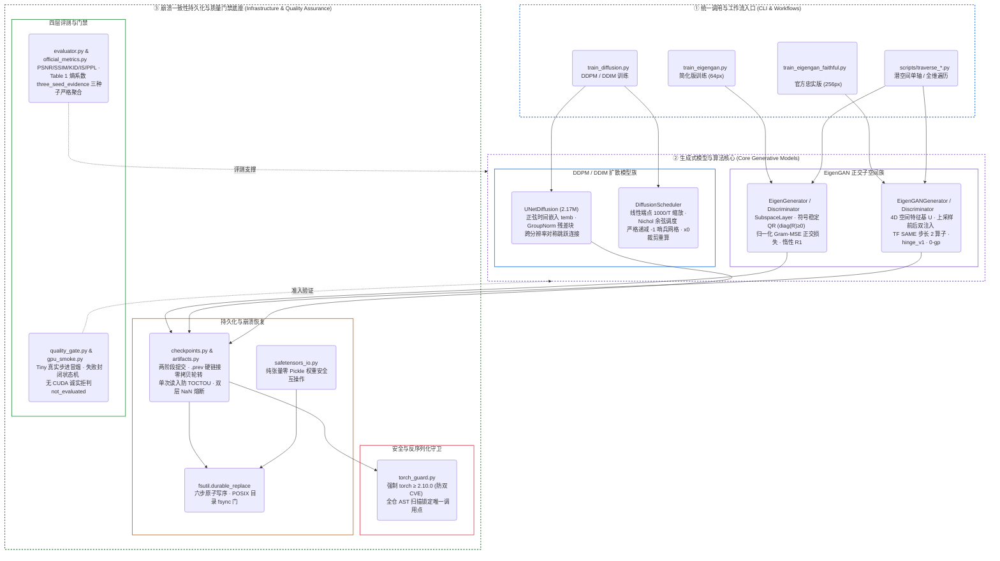

# EigenForge：层级正交子空间 EigenGAN 与 DDPM/DDIM 扩散模型生成套件

本项目为生成式模型教学与工程复现套件 **EigenForge**（Python 包名 `eigenforge`），遵循标准 **PyPA `src`-layout** 开源结构：

- **EigenGAN 层级正交子空间人脸生成**——简化教学变体 + 官方 TensorFlow 架构对拍实现；
- **DDPM/DDIM 扩散模型**；
- 内置确定性冒烟协议、三种子质量门禁、带 SHA-256 溯源清单的原子 Checkpoint 协议与轻量/官方指标评测体系。

> **质量声明边界**：本仓库内置 PPL/KID/IS 为无外部网络依赖的轻量代理指标；与论文数值横向对标必须启用 `clean-fid` / `torch-fidelity` 官方后端并在固定 GPU 与完整 CelebA 数据协议下执行。训练与评测边界详见 [docs/MODEL_CARD.md](docs/MODEL_CARD.md)。

---

## 系统架构全景图



---

## 目录结构

```text
eigenforge/
├── .github/                              # CI 工作流与 GitHub 社区治理规范
│   ├── ISSUE_TEMPLATE/                   # Bug 报告与功能请求模板
│   ├── workflows/ci.yml                  # GitHub Actions 自动化门禁
│   ├── CODE_OF_CONDUCT.md                # 社区行为准则
│   ├── CONTRIBUTING.md                   # 贡献指南与验证清单
│   ├── PULL_REQUEST_TEMPLATE.md          # PR 自检清单模板
│   └── SECURITY.md                       # 安全漏洞披露与 PyTorch CVE 防护说明
├── configs/
│   └── eigenforge.yaml                     # 训练与评测超参只读参考镜像（不被运行时代码加载）
├── docs/
│   ├── INDEX.md                          # 文档体系总览与源码双向导航索引
│   ├── MODEL_CARD.md            # 模型架构卡片、与官方实现差异对拍记录及评测边界
│   ├── ARCHITECTURE_AND_MATHEMATICS.md   # 模型架构与数学规范（EigenGAN / 忠实版 / DDPM / DDIM / 闭式 MLE）
│   ├── EVALUATION_AND_QUALITY_GATES.md   # 评测指标体系、三种子证据聚合与失败封闭质量门禁
│   ├── CHECKPOINT_AND_SECURITY_SPEC.md   # 崩溃一致性 Checkpoint 协议、原子写原语与 PyTorch CVE 防护
│   └── CLI_AND_CONFIGURATION_REFERENCE.md # 全量 CLI 参数、配置边界与退出码参考手册
├── scripts/
│   ├── __init__.py
│   ├── gpu_smoke.py                      # GPU/CPU 训练管线冒烟（无 CUDA 时如实标注 not_evaluated）
│   ├── quality_gate.py                   # 三随机种子质量门禁（protocol / evaluate 双模式，失败封闭）
│   ├── traverse_eigen_dims.py            # 简化版 EigenGAN 潜空间语义轴遍历导出
│   └── traverse_eigengan_faithful.py     # 官方版 EigenGAN 按 |L| 降序全维度遍历导出
├── src/
│   └── eigenforge/                   # 核心源码包（标准 PyPA src-layout）
│       ├── __init__.py
│       ├── common/
│       │   ├── __init__.py
│       │   ├── config.py                 # AppConfig（Pydantic v2 BaseSettings，读取环境变量与 .env）
│       │   ├── fsutil.py                 # 耐久原子写原语（临时文件 + flush/fsync + os.replace + POSIX 目录 fsync）
│       │   ├── logger.py                 # Loguru 结构化/控制台日志与延迟文件 sink
│       │   └── torch_guard.py            # PyTorch 反序列化安全版本守卫（强制 torch >= 2.10.0）
│       ├── evaluation/
│       │   ├── __init__.py
│       │   ├── evaluator.py              # PSNR / SSIM / KID / IS / PPL 代理指标与潜空间正交轴遍历图
│       │   ├── official_metrics.py       # 可选 clean-fid / torch-fidelity / lpips 官方后端适配与三种子证据聚合
│       │   ├── entropy_coefficient.py    # 论文 Table 1 属性条件熵系数 Eq. (6)-(10)
│       │   ├── linear_case_mle.py        # 论文附录 A Eq. (43)-(46) 线性情形闭式 MLE 解
│       │   └── toy_basis_similarity.py   # 论文 Tables 2-3 线性 EigenGAN 对抗训练与 PCA 基余弦相似度实验
│       ├── models/
│       │   ├── __init__.py
│       │   ├── eigengan.py               # EigenGAN 简化变体（QR 符号稳定化 + 归一化 Gram-MSE 正交损失）
│       │   ├── eigengan_faithful.py      # 对照官方 LynnHo/EigenGAN-Tensorflow (ICCV 2021) 的忠实架构实现
│       │   ├── diffusion_scheduler.py    # DDPM 前向加噪 / 反演与 DDIM 采样调度器（时间网格以 -1 哨兵结尾）
│       │   └── unet_diffusion.py         # 时间步正弦嵌入 + GroupNorm 残差 U-Net
│       ├── scripts/
│       │   └── __init__.py               # 桥接 eigenforge.scripts.* 至顶层 scripts/ 目录
│       ├── artifacts.py                  # 训练产物追溯清单（SHA-256、超参配置、种子、Git commit）
│       ├── checkpoints.py                # Checkpoint 原子提交、单次读入 SHA-256 校验、.prev 回退与 NaN 熔断
│       ├── safetensors_io.py             # 可选 safetensors 纯张量权重安全导出与加载
│       ├── smoke.py                      # 核心冒烟步进与跨种子统计聚合
│       ├── train_eigengan.py             # EigenGAN 训练入口（含惰性 R1 正则与 EMA warm-up）
│       ├── train_eigengan_faithful.py    # 官方架构 EigenGAN 训练入口
│       └── train_diffusion.py            # DDPM/DDIM 扩散模型训练入口
├── tests/                                # 单元测试与安全/持久性契约回归套件（含 conftest.py）
├── .env.example                          # 环境变量示例配置
├── .gitignore                            # Git 忽略规则
├── AGENTS.md                             # 智能体与开发者协作工作约定
├── CITATION.cff                          # 学术论文与软件引用元数据
├── LICENSE                               # MIT 开源许可证
└── pyproject.toml                        # PEP 621 标准打包与工具链配置
```

---

## 文档体系导航

全部技术文档的定位与核心内容汇总如下：

| 文档 | 核心内容 |
| :--- | :--- |
| **[docs/INDEX.md](docs/INDEX.md)** | 文档体系总览、按角色阅读路线与“源码模块 $\leftrightarrow$ 文档章节 $\leftrightarrow$ 测试套件”双向索引 |
| **[docs/MODEL_CARD.md](docs/MODEL_CARD.md)** | 模型身份、实测参数量、与官方 `LynnHo/EigenGAN-Tensorflow` 的逐项对拍记录及质量声明红线 |
| **[docs/ARCHITECTURE_AND_MATHEMATICS.md](docs/ARCHITECTURE_AND_MATHEMATICS.md)** | 简化版/官方版 EigenGAN、DDPM/DDIM 调度器与 U-Net、论文附录 A 闭式 MLE 及 Tables 2–3 的完整数学规范 |
| **[docs/EVALUATION_AND_QUALITY_GATES.md](docs/EVALUATION_AND_QUALITY_GATES.md)** | PSNR/SSIM/KID/IS/PPL 代理指标、Table 1 熵系数、可选官方后端、三种子聚合与失败封闭门禁状态机 |
| **[docs/CHECKPOINT_AND_SECURITY_SPEC.md](docs/CHECKPOINT_AND_SECURITY_SPEC.md)** | `torch >= 2.10.0` 双 CVE 防护、`fsutil` 耐久原子替换、两阶段 Checkpoint 提交、防 TOCTOU 单次读入校验与 NaN 熔断 |
| **[docs/CLI_AND_CONFIGURATION_REFERENCE.md](docs/CLI_AND_CONFIGURATION_REFERENCE.md)** | `AppConfig` vs `configs/eigenforge.yaml` 职责边界，以及全部 8 个 CLI 入口的参数表与退出码规范 |

---

## 快速上手

### 1. 环境安装

要求 **Python >= 3.10** 且 **PyTorch >= 2.10.0**（覆盖 `torch.load(weights_only=True)` 的历史安全绕过漏洞 CVE-2025-32434 与 CVE-2026-24747）：

```bash
python -m venv .venv
# Windows: .venv\Scripts\activate
# Linux/macOS: source .venv/bin/activate

pip install -e ".[dev]"
# 可选官方评测后端与 safetensors 支持：
# pip install -e ".[eval,safetensors]"
```

### 2. 配置（可选）

```bash
cp .env.example .env
```

运行时配置通过 CLI 参数与环境变量 / `.env` 读取；`configs/eigenforge.yaml` 为只读教学参考镜像。

### 3. 运行测试与质量协议门禁

```bash
# 运行完整单元测试套件
pytest -v

# 静态检查与编译验证
ruff check .
python -m compileall -q .

# 训练管线冒烟（CPU 下如实报告 quality_gate="not_evaluated"，GPU runner 可加 --require-cuda）
python scripts/gpu_smoke.py --seeds 0 --steps 2

# 三种子质量门禁协议验证
python scripts/quality_gate.py --seeds 0 --train-steps 2 --mode protocol
```

### 4. 模型训练与潜空间遍历

需自行准备 `ImageFolder` 结构的 CelebA 数据集（默认路径 `./data/celeba`）：

```bash
# 训练简化版 EigenGAN（默认 64x64，惰性 R1 每 16 步执行一次）
python -m eigenforge.train_eigengan --data-root ./data/celeba --epochs 50

# 训练官方布局版 EigenGAN（256x256，6 层，hinge_v1 + 0-gp）
python -m eigenforge.train_eigengan_faithful --data-root ./data/celeba --epochs 160

# 训练 DDPM/DDIM 扩散模型
python -m eigenforge.train_diffusion --data-root ./data/celeba --epochs 100

# 导出潜空间子空间正交轴遍历网格图（默认校验同旁 .manifest.json 的 SHA-256）
python scripts/traverse_eigen_dims.py --checkpoint experiments/eigengan/latest.pt --output experiments/demo/traversal.png
```

---

## 核心工程与数学约束

1. **正交正则尺度固定**：`EigenGenerator.total_orthogonality_loss()` 使用按层数与基向量数归一化的 Gram-MSE，前向 QR 分解强制符号稳定（`diag(R) ≥ 0`）——不得改为未归一化的 Frobenius 求和（推导见 [ARCHITECTURE_AND_MATHEMATICS.md](docs/ARCHITECTURE_AND_MATHEMATICS.md) §1.2）。
2. **DDIM 严格递减网格**：时间网格严格递减且以哨兵 `-1` 结尾；采样默认将预测 x₀ 裁剪至 [-1, 1] 并据此重算噪声（§3.1）。
3. **惰性 R1 正则**：判别器梯度惩罚每 16 步才构建一次二阶计算图，非正则步零额外开销（§1.4）。
4. **Checkpoint 安全**：所有 `torch.load` 统一收口于 `checkpoints.load_checkpoint(..., weights_only=True)`，单次读入内存防 TOCTOU，损坏时自动回退 `.prev` 上一代硬链接（详见 [CHECKPOINT_AND_SECURITY_SPEC.md](docs/CHECKPOINT_AND_SECURITY_SPEC.md)）。

---

## 开源治理与致谢

- 本项目采用 [MIT License](LICENSE) 开源，学术引用信息见 [CITATION.cff](CITATION.cff)。
- **官方实现对拍来源**：[`LynnHo/EigenGAN-Tensorflow`](https://github.com/LynnHo/EigenGAN-Tensorflow)（MIT License, Copyright (c) 2021 Zhenliang He）与论文 *EigenGAN: Layer-Wise Eigen-Learning for GANs* (ICCV 2021)。
- **对应文件**：`src/eigenforge/models/eigengan_faithful.py`、`src/eigenforge/train_eigengan_faithful.py`、`scripts/traverse_eigengan_faithful.py`。
- **社区文档**：贡献指南见 [.github/CONTRIBUTING.md](.github/CONTRIBUTING.md)，安全漏洞报告策略见 [.github/SECURITY.md](.github/SECURITY.md)，社区行为准则见 [.github/CODE_OF_CONDUCT.md](.github/CODE_OF_CONDUCT.md)。
