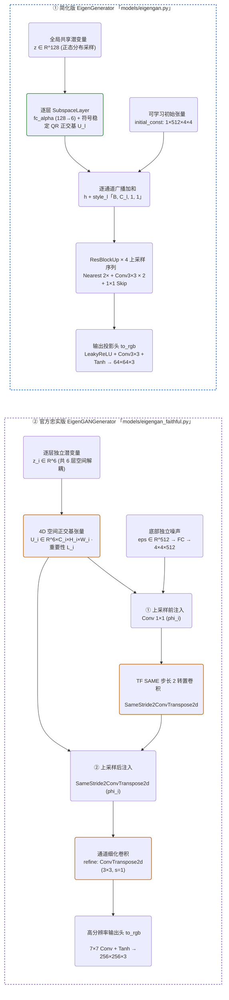
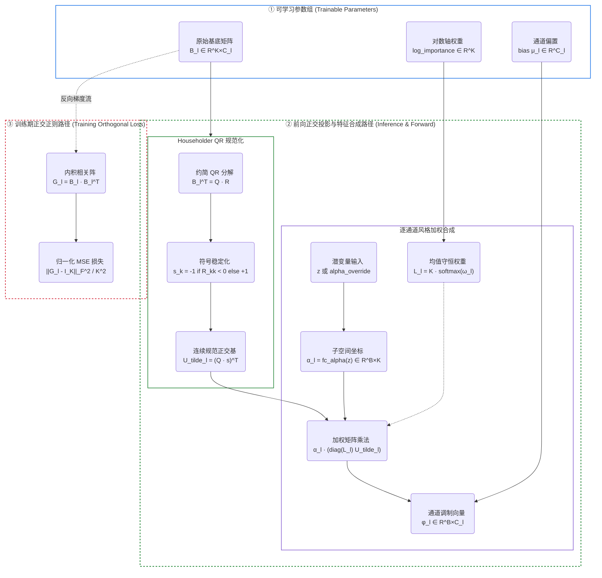
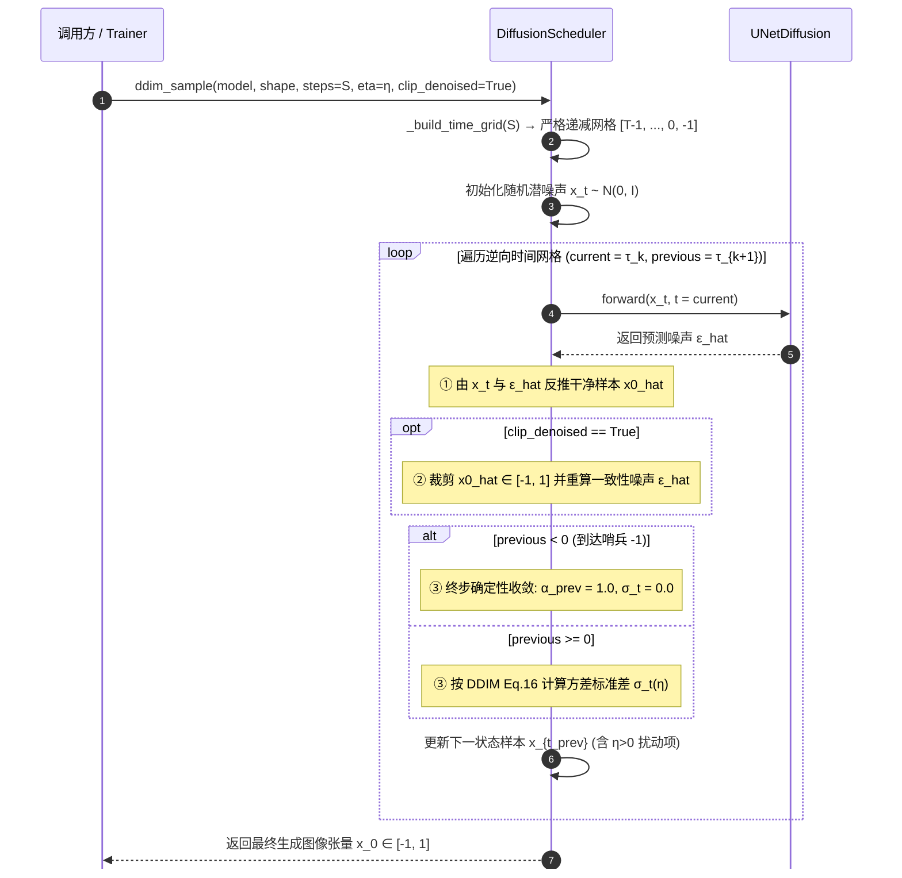
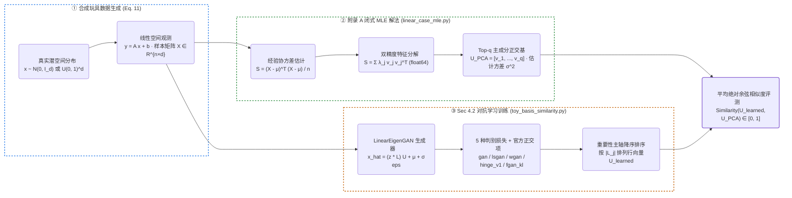

# 模型架构与数学规范（Architecture & Mathematical Specification）

本文档深入阐述 `eigenforge` 中四大核心算法模块的网络拓扑、张量形状变换、损失函数尺度、数值稳定性机制与代码落点。全文公式统一编号 (1.1)–(4.6)，关键数据流与网络拓扑配有架构图与时序图。

**图表与公式索引**：架构对比见图 1、SubspaceLayer 数据流见图 2、DDIM 采样时序见图 3、UNet 拓扑见图 4、线性基准闭环见图 5；符号约定见表 1–4；全部公式编号见式 (1.1)–(4.6)。

---

## 符号与记号约定（Nomenclature）

全部公式的符号按下述四个语义组约定；同一符号跨组复用时以局部定义为准，下标 $l$/$i$ 统一指层序号。

**表 1　EigenGAN 简化版符号（`src/eigenforge/models/eigengan.py`）**

| 符号 | 含义 | 首现公式 |
| :--- | :--- | :---: |
| $B_l$ | 第 $l$ 层可学习基底矩阵（行正交初始化） | (1.1) |
| $C_l$ | 第 $l$ 层输出通道数（阶段 $i$ 记作 $C_i$） | (1.1) |
| $B$ | 批大小 | (1.2) |
| $d_z$ | 全局潜向量维度（默认 128） | §1.2 正文 |
| $\alpha_l$ | 第 $l$ 层子空间坐标（`fc_alpha(z)` 或外部覆盖） | (1.2) |
| $K$ | 每层子空间基向量数 `n_basis`（默认 6） | (1.1) |
| $\boldsymbol{\omega}_l$ | 对数重要性参数 `log_importance` | (1.3) |
| $L_l$ | 归一化对角重要性 $K\cdot\operatorname{softmax}(\boldsymbol{\omega}_l)$ | (1.3) |
| $Q, R$ | $B_l^\top$ 的约简 QR 分解因子 | (1.4) |
| $s_k$ | 符号稳定化因子（$R_{kk}<0$ 取 $-1$，否则 $+1$） | (1.5) |
| $\tilde{U}_l$ | 符号稳定的连续正交基 | (1.5) |
| $\mu_l$ | 通道偏置 `bias` | (1.6) |
| $\phi_l$ | 输出通道调制向量 | (1.6) |
| $I_K$ | $K$ 阶单位矩阵 | (1.7) |
| $\mathcal{L}_{\text{ortho}}$ | 归一化 Gram-MSE 正交正则项 | (1.7) |
| $L$ | 生成器层数 $\log_2(\text{img\_size})-1$ | (1.8) |
| $\sigma(\cdot)$ | 非就地 LeakyReLU$(0.2)$ 激活（`to_rgb` 输出头使用 `inplace=True` 为唯一例外） | (1.11) |
| $C_i$ | 第 $i$ 阶段通道数 | (1.12) |
| $D, G$ | 判别器 / 生成器映射 | (1.13) |
| $\gamma, k$ | R1 权重（默认 10）与惰性间隔（默认 16） | (1.15) |
| $\lambda_{\text{ortho}}$ | 正交项权重 `--ortho-weight` | (1.16) |

**表 2　EigenGAN 官方布局版符号（`src/eigenforge/models/eigengan_faithful.py`）**

| 符号 | 含义 | 首现公式 |
| :--- | :--- | :---: |
| $q_i$ | 第 $i$ 层子空间维度（默认 6） | (2.1) |
| $z_i$ | 逐层独立潜变量 | (2.1) |
| $\varepsilon$ | 底部高斯噪声（经 FC 映射为 4×4×512） | (2.7) |
| $U_i$ | 4D 空间正交基张量 $[q_i, C_i, H_i, W_i]$ | (2.1) |
| $L_i$ | 对角重要度初值 $[3q_i, 3(q_i-1), \dots, 3]$ | (2.1) |
| $\mu_i$ | 空间偏置张量 | (2.1) |
| $\Phi_i$ | 合成的子空间特征图 | (2.1) |
| $h_i$ | 第 $i$ 阶段输入特征图 | (2.2) |
| $\text{gain}, \sigma$ | 官方初始化增益与截断正态标准差（勿与激活 $\sigma(\cdot)$ 混淆） | (2.6) |
| $p, \lambda_{\text{gp}}$ | `0-gp` 惰性周期（3）与权重（10） | (2.8) |
| $E, e_{\text{start}}, \eta_0$ | 总轮数、衰减起始轮与初始学习率 | (2.10) |

**表 3　扩散模型符号（`src/eigenforge/models/diffusion_scheduler.py` / `unet_diffusion.py`）**

| 符号 | 含义 | 首现公式 |
| :--- | :--- | :---: |
| $T$ | 总扩散步数 `num_timesteps` | (3.1) |
| $\beta_t$ | $t$ 步噪声系数 | (3.1) |
| $\alpha_t = 1-\beta_t$ | $t$ 步保留系数 | (3.4) |
| $\bar{\alpha}_t$ | 累积信噪系数 $\prod_{j=1}^{t}(1-\beta_j)$ | (3.1) |
| $s$ | 线性调度端点缩放因子 $1000/T$ | (3.1) |
| $x_0, x_t$ | 干净样本与 $t$ 步加噪样本 | (3.3) |
| $\varepsilon$ | 标准高斯噪声 | (3.3) |
| $\hat{\varepsilon}_\theta$ | U-Net 预测噪声 | (3.4) |
| $\tilde{\mu}_\theta, \tilde{\beta}_t$ | DDPM 后验均值与方差 | (3.4) |
| $\hat{x}_0$ | 由 $x_t$ 反推的干净样本预测 | (3.6) |
| $\hat{\varepsilon}$ | 由裁剪后 $\hat{x}_0$ 重算的一致性噪声（区别于网络预测 $\hat{\varepsilon}_\theta$） | (3.6) |
| $\sigma_t(\eta)$ | DDIM 转移标准差（$\eta\in[0,1]$） | (3.7) |
| $\omega_k$ | 正弦嵌入几何级数频率 | (3.8) |
| $n$ | EMA 全局更新步 | (3.9) |

**表 4　线性闭式 MLE 与实验符号（`src/eigenforge/evaluation/linear_case_mle.py` / `toy_basis_similarity.py`）**

| 符号 | 含义 | 首现公式 |
| :--- | :--- | :---: |
| $X$ | 样本矩阵 $\mathbb{R}^{n\times d}$（$n\ge 2$） | (4.2) |
| $\hat{\mu}$ | 样本均值 | (4.1) |
| $S$ | 经验协方差（按 $1/n$ 归一化） | (4.2) |
| $\lambda_j, v_j$ | 降序特征值与特征向量对 | (4.2) |
| $q, d$ | 子空间维度与数据维度（$1\le q<d$） | (4.3) |
| $\hat{\sigma}^2$ | 各向同性噪声方差估计 | (4.3) |
| $\hat{L}_j$ | 子空间重要性 | (4.4) |
| $\hat{U}$ | Top-$q$ 正交基（即 PCA 基） | (4.5) |
| $A, b$ | 玩具数据线性变换与平移 | §4.2 正文 / 图 5 |

---

## 1. 简化版 EigenGAN（`src/eigenforge/models/eigengan.py`）

简化版 EigenGAN 是面向教学与 64×64 人脸生成实验的紧凑实现（生成器 **7.50M** 参数，判别器 **6.57M** 参数），通过在每个上采样阶段前注入正交子空间特征向量，实现跨分辨率层级的语义控制。

### 1.1 简化版与官方布局版架构对比图

**图 1　简化版与官方布局版 EigenGANGenerator 架构对比**

### 1.2 子空间层 `SubspaceLayer` 数据流与数学定义

**图 2　SubspaceLayer 前向投影与正交正则双路径数据流**

给定全局潜变量 $z \in \mathbb{R}^{B \times d_z}$（默认 $d_z = 128$），第 $l$ 层 `SubspaceLayer(in_dim=d_z, out_dim=C_l, n_basis=K)`（默认 $K = 6$）包含以下参数与映射：

1. **原始基底矩阵** `basis`（要求 $1 \le K \le C_l$，默认 `nn.init.orthogonal_` 行正交初始化）：

$$
B_l \in \mathbb{R}^{K \times C_l}
\tag{1.1}
$$

2. **子空间坐标映射** `fc_alpha`（当外部未提供 `alpha_override` 时）：

$$
\alpha_l = \operatorname{fc\_alpha}(z) \in \mathbb{R}^{B \times K}
\tag{1.2}
$$

3. **均值守恒的对角重要性权重** `importance()`（`eigengan.py:87-89`）：

$$
L_l = K \cdot \operatorname{softmax}(\boldsymbol{\omega}_l) \in \mathbb{R}_+^K, \qquad \frac{1}{K}\sum_{k=1}^K L_{l,k} = 1
\tag{1.3}
$$

#### 符号稳定化 Householder QR（`get_orthonormal_basis`）

在前向推理（`strict_qr=True`）时，代码对转置基底 $B_l^\top \in \mathbb{R}^{C_l \times K}$ 执行约简 QR 分解：

$$
B_l^\top = Q R, \qquad Q \in \mathbb{R}^{C_l \times K}, \quad R \in \mathbb{R}^{K \times K}
\tag{1.4}
$$

由于标准 Householder QR 分解对每一列的符号不唯一，当训练过程中 $B_l$ 某个元素跨过 0 时，$Q$ 的对应列会发生 $\cos = -1$ 的瞬时翻号（实测参数仅变化 $10^{-5}$ 时，$Q$ 最大跳变达 $1.21$）。

`get_orthonormal_basis()`（`eigengan.py:58-66`）通过强制 $\operatorname{diag}(R) \ge 0$ 唯一确定列方向：

$$
s_k = \begin{cases} -1, & R_{kk} < 0 \\ +1, & R_{kk} \ge 0 \end{cases}, \qquad \tilde{U}_l = \big(Q \cdot \operatorname{diag}(s_1, \dots, s_K)\big)^\top \in \mathbb{R}^{K \times C_l}
\tag{1.5}
$$

最终第 $l$ 层输出的通道调制向量为：

$$
\phi_l(z) = \alpha_l \big(\operatorname{diag}(L_l)\,\tilde{U}_l\big) + \mu_l \in \mathbb{R}^{B \times C_l}
\tag{1.6}
$$

#### 正交正则损失尺度（`orthogonality_loss`）

正交损失直接作用于未做 QR 投影的可学习参数 $B_l$。`orthogonality_loss(scale=...)`（`eigengan.py:68-83`）支持两种尺度：

- **`scale="normalized"`（默认，项目不可违反硬约束）**：

$$
\mathcal{L}_{\text{ortho}}^{\text{norm}}(B_l) = \operatorname{MSE}(B_l B_l^\top, I_K) = \frac{1}{K^2}\|B_l B_l^\top - I_K\|_F^2
\tag{1.7}
$$

生成器的总正交损失 `EigenGenerator.total_orthogonality_loss()` 对所有 $L = \log_2(\text{img\_size}) - 1$ 个子空间层取均值：

$$
\mathcal{L}_{\text{ortho}}^{\text{total}} = \frac{1}{L}\sum_{l=0}^{L-1} \frac{1}{K^2}\|B_l B_l^\top - I_K\|_F^2
\tag{1.8}
$$

- **`scale="sum_half"`（对齐官方 TensorFlow 尺度）**：

$$
\mathcal{L}_{\text{ortho}}^{\text{sum\_half}}(B_l) = \frac{1}{2}\|B_l B_l^\top - I_K\|_F^2
\tag{1.9}
$$

- **跨实现尺度换算恒等式**（在 $K=6, L=5$ 即 64×64 分辨率下精确为 **90 倍**）：

$$
\frac{\sum_{l=0}^{L-1} \mathcal{L}_{\text{ortho}}^{\text{sum\_half}}(B_l)}{\mathcal{L}_{\text{ortho}}^{\text{total}}} = \frac{1}{2} K^2 L = 0.5 \times 6^2 \times 5 = 90
\tag{1.10}
$$

### 1.3 上采样残差块 `ResBlockUp` 与非就地激活约束

`ResBlockUp(in_channels, out_channels)`（`eigengan.py:105-120`）执行 2 倍最近邻上采样与双卷积残差连接：

$$
h_0 = \operatorname{Upsample}_{2\times}(x), \qquad \operatorname{ResBlockUp}(x) = \operatorname{Conv}_{3\times 3}\big(\sigma(\operatorname{Conv}_{3\times 3}(\sigma(h_0)))\big) + \operatorname{Conv}_{1\times 1}(h_0)
\tag{1.11}
$$

其中激活函数 $\sigma$ 为 `nn.LeakyReLU(0.2, inplace=False)`。**严禁改为 `inplace=True`**：因为跳跃分支 $\operatorname{Conv}_{1\times 1}(h_0)$ 的反向传播需要读取未修改的 $h_0$ 计算卷积核梯度，就地激活会破坏前向保存的激活张量。

### 1.4 生成器阶段拓扑与惰性 R1 梯度惩罚

对于默认 `img_size = 64`（阶段数 $L = \log_2(64) - 1 = 5$），第 $i$ 阶段的通道数见式 (1.12) 与表 5：

$$
C_i = \min\left(\text{max\_channels}, \; \text{base\_channels} \cdot 2^{L - 1 - i}\right)
\tag{1.12}
$$

**表 5　EigenGenerator 五阶段通道与子空间注入拓扑**

| 阶段 $i$ | 输入空间尺寸 | 通道数 $C_i$ | 子空间注入 `subspace_layers[i]` | 上采样块 `blocks[i]` | 输出空间尺寸 |
| :---: | :---: | :---: | :--- | :--- | :---: |
| 0 | $4 \times 4$ | 512 | `SubspaceLayer(128, 512, 6)` | `ResBlockUp(512, 512)` | $8 \times 8$ |
| 1 | $8 \times 8$ | 512 | `SubspaceLayer(128, 512, 6)` | `ResBlockUp(512, 256)` | $16 \times 16$ |
| 2 | $16 \times 16$ | 256 | `SubspaceLayer(128, 256, 6)` | `ResBlockUp(256, 128)` | $32 \times 32$ |
| 3 | $32 \times 32$ | 128 | `SubspaceLayer(128, 128, 6)` | `ResBlockUp(128, 64)` | $64 \times 64$ |
| 4 | $64 \times 64$ | 64 | `SubspaceLayer(128, 64, 6)` | `to_rgb` (`LeakyReLU` $\to$ `Conv3x3` $\to$ `Tanh`) | $64 \times 64 \times 3$ |

判别器与生成器的 Hinge 对抗损失及惰性 R1 梯度惩罚（`train_eigengan.py:129-164`，默认间隔 $k = 16, \; \gamma = 10.0$）定义为：

$$
\mathcal{L}_D^{\text{hinge}} = \mathbb{E}_{x\sim p_{\text{data}}}\big[\max(0, 1 - D(x))\big] + \mathbb{E}_{z\sim \mathcal{N}(0,I)}\big[\max(0, 1 + D(G(z)))\big]
\tag{1.13}
$$

$$
\mathcal{R}_1(D) = \frac{1}{2}\mathbb{E}_{x\sim p_{\text{data}}}\left[\|\nabla_x D(x)\|_2^2\right]
\tag{1.14}
$$

$$
\mathcal{L}_D^{\text{total}}(\text{step}) = \mathcal{L}_D^{\text{hinge}} + \mathbb{I}(\text{step} \bmod k = 0) \cdot (\gamma k) \cdot \mathcal{R}_1(D)
\tag{1.15}
$$

$$
\mathcal{L}_G^{\text{simplified}} = -\mathbb{E}_{z\sim \mathcal{N}(0,I)}\big[D(G(z))\big] + \lambda_{\text{ortho}}\,\mathcal{L}_{\text{ortho}}^{\text{total}}
\tag{1.16}
$$

---

## 2. 官方布局忠实版 EigenGAN（`src/eigenforge/models/eigengan_faithful.py`）

该模块严格对照 [`LynnHo/EigenGAN-Tensorflow`](https://github.com/LynnHo/EigenGAN-Tensorflow)（commit `fc3e1a2`，ICCV 2021）实现，架构标识为 `ARCHITECTURE_TAG = "eigengan_official_layout"`。

### 2.1 4D 空间特征基与双次注入公式

第 $i$ 层拥有：

- 独立的潜变量 $z_i \sim \mathcal{N}(0, I_{q_i})$；
- 4D 空间正交基张量 $U_i \in \mathbb{R}^{q_i \times C_i \times H_i \times W_i}$；
- 对角重要度向量 $L_i = [3q_i, 3(q_i-1), \dots, 3]^\top$；
- 偏置 $\mu_i \in \mathbb{R}^{C_i \times H_i \times W_i}$。

其合成的子空间特征图为：

$$
\Phi_i(z_i) = \sum_{k=1}^{q_i} z_{i,k}\,L_{i,k}\,U_{i,k} + \mu_i \in \mathbb{R}^{B \times C_i \times H_i \times W_i}
\tag{2.1}
$$

第 $i$ 阶段的完整特征递推方程（`eigengan_faithful.py:254-259`，其中激活函数 $\sigma$ 为 `F.leaky_relu(..., 0.2)`，上采样前后各注入一次 $\Phi_i$，并在第二次注入后接 $3\times 3$ 步长 1 细化卷积 `refine`）：

$$
\tilde{h}_i = \operatorname{SameStride2ConvTranspose2d}\Big(\sigma\big(h_i + \operatorname{Conv}_{1\times 1}(\Phi_i(z_i))\big)\Big)
\tag{2.2}
$$

$$
h_{i+1} = \operatorname{ConvTranspose2d}_{k=3,s=1,p=1}\Big(\sigma\big(\tilde{h}_i + \operatorname{SameStride2ConvTranspose2d}(\Phi_i(z_i))\big)\Big)
\tag{2.3}
$$

### 2.2 TensorFlow `SAME` 步长 2 非对称填充算子

对于偶数空间尺寸 $2n \times 2n$ 与 $3\times 3$、步长 2 卷积，TensorFlow `SAME` 仅在底部与右侧补 1 个像素，而转置卷积是该算子的精确线性伴随（先做 `padding=0` 的完整转置卷积得到 $(2n+1)\times(2n+1)$，再截去最后一行与最后一列）：

$$
\operatorname{SameStride2Conv2d}(x) = \operatorname{Conv2d}_{k=3,s=2,p=0}\big(\operatorname{Pad}_{(0,1,0,1)}(x)\big)
\tag{2.4}
$$

$$
\operatorname{SameStride2ConvTranspose2d}(x) = \Big[\operatorname{ConvTranspose2d}_{k=3,s=2,p=0}(x)\Big]_{:, :, :-1, :-1}
\tag{2.5}
$$

### 2.3 官方截断正态初始化、损失函数与学习率调度

1. **截断正态方差缩放初始化（`official_init_`）**：

$$
\text{gain} = \sqrt{\frac{2}{1 + 0.2^2}}, \qquad \sigma = \frac{\text{gain}}{\sqrt{\text{fan\_in}} \cdot 0.87962566103423978}, \qquad W \sim \mathcal{TN}(0, \sigma^2; -2\sigma, 2\sigma)
\tag{2.6}
$$

2. **官方 `hinge_v1` 生成器损失、惰性 `0-gp`（周期 $p=3$，权重 $\lambda_{\text{gp}}=10$）与未归一化正交项**：

$$
\mathcal{L}_G^{\text{hinge\_v1}} = \mathbb{E}\big[\max(0, 1 - D(G(\{z_i\}, \varepsilon)))\big]
\tag{2.7}
$$

$$
\mathcal{L}_{\text{0-gp}}(D) = \mathbb{E}_{x\sim p_{\text{data}}}\left[\|\nabla_x D(x)\|_2^2\right], \qquad \mathcal{L}_D^{\text{faithful}}(\text{step}) = \mathcal{L}_D^{\text{hinge\_v1}} + \mathbb{I}(\text{step} \bmod p = 0) \cdot (\lambda_{\text{gp}}\, p) \cdot \mathcal{L}_{\text{0-gp}}(D)
\tag{2.8}
$$

$$
\mathcal{L}_{\text{ortho}}^{\text{official}}(U) = \sum_{i=0}^{L-1}\frac{1}{2}\big\|\operatorname{vec}(U_i)\operatorname{vec}(U_i)^\top - I_{q_i}\big\|_F^2
\tag{2.9}
$$

3. **线性学习率衰减调度（`linear_decay_lr`）**：

$$
\eta(e) = \begin{cases} \eta_0, & e < e_{\text{start}} \\ \eta_0 \left(1 - \dfrac{e - e_{\text{start}} + 1}{E - e_{\text{start}} + 1}\right), & e \ge e_{\text{start}} \end{cases}
\tag{2.10}
$$

---

## 3. DDPM / DDIM 扩散模型（`diffusion_scheduler.py` & `unet_diffusion.py`）

### 3.1 扩散调度器 `DiffusionScheduler` 与采样时序图

**图 3　DDIM 逆向采样交互时序**

#### 噪声调度方程（Endpoint-Rescaled Linear & Cosine）

- **按 $1000/T$ 端点缩放的线性调度（`schedule_type="linear"`）**：

$$
s = \frac{1000}{T}, \qquad \beta_t = \min\Big(0.9999, \; \operatorname{linspace}(s\beta_{\text{start}}, \, s\beta_{\text{end}}, \, T)_t\Big), \qquad \bar{\alpha}_t = \prod_{j=1}^t (1 - \beta_j)
\tag{3.1}
$$

- **Nichol & Dhariwal 余弦调度（`schedule_type="cosine"`，偏移量 $s_0 = 0.008$）**：

$$
f(t) = \cos^2\left(\frac{t/T + 0.008}{1 + 0.008}\cdot \frac{\pi}{2}\right), \qquad \bar{\alpha}_t = \frac{f(t)}{f(0)}, \qquad \beta_t = \operatorname{clamp}\left(1 - \frac{\bar{\alpha}_t}{\bar{\alpha}_{t-1}}, \; 10^{-4}, \; 0.9999\right)
\tag{3.2}
$$

#### 前向加噪与逆向 DDPM / DDIM 转移方程

- **前向边际分布 $q(x_t | x_0)$（`q_sample`）**：

$$
x_t = \sqrt{\bar{\alpha}_t}\,x_0 + \sqrt{1 - \bar{\alpha}_t}\,\varepsilon, \qquad \varepsilon \sim \mathcal{N}(0, I)
\tag{3.3}
$$

- **DDPM 单步逆向后验采样 $p_\theta(x_{t-1} | x_t)$（`p_sample`）**：

$$
\tilde{\mu}_\theta(x_t, t) = \frac{1}{\sqrt{\alpha_t}}\left(x_t - \frac{\beta_t}{\sqrt{1 - \bar{\alpha}_t}}\hat{\varepsilon}_\theta(x_t, t)\right), \qquad \tilde{\beta}_t = \frac{1 - \bar{\alpha}_{t-1}}{1 - \bar{\alpha}_t}\beta_t
\tag{3.4}
$$

$$
x_{t-1} = \tilde{\mu}_\theta(x_t, t) + \mathbb{I}(t > 0)\sqrt{\max(\tilde{\beta}_t, 10^{-20})}\,z, \qquad z \sim \mathcal{N}(0, I)
\tag{3.5}
$$

- **DDIM 逆向更新方程与 $\hat{x}_0$ 裁剪重算（`ddim_sample`）**：

$$
\hat{x}_0 = \operatorname{clamp}\left(\frac{x_t - \sqrt{1 - \bar{\alpha}_t}\,\hat{\varepsilon}_\theta(x_t, t)}{\sqrt{\bar{\alpha}_t}}, \; -1, \; 1\right), \qquad \hat{\varepsilon} = \frac{x_t - \sqrt{\bar{\alpha}_t}\,\hat{x}_0}{\sqrt{1 - \bar{\alpha}_t}}
\tag{3.6}
$$

$$
\sigma_t(\eta) = \eta \sqrt{\frac{1 - \bar{\alpha}_{\text{prev}}}{1 - \bar{\alpha}_t}} \sqrt{1 - \frac{\bar{\alpha}_t}{\bar{\alpha}_{\text{prev}}}}, \qquad x_{t_{\text{prev}}} = \sqrt{\bar{\alpha}_{\text{prev}}}\,\hat{x}_0 + \sqrt{\max\big(0, \, 1 - \bar{\alpha}_{\text{prev}} - \sigma_t(\eta)^2\big)}\,\hat{\varepsilon} + \sigma_t(\eta) z
\tag{3.7}
$$

### 3.2 时间条件去噪网络 `UNetDiffusion` 拓扑图

```mermaid
%%{init: {'flowchart': {'nodeSpacing': 80, 'rankSpacing': 85, 'padding': 16, 'diagramPadding': 14}}}%%
flowchart TB
    subgraph time_branch["　　① 正弦时间嵌入分支 (Sinusoidal Embedding)　　"]
        T(" 　<br/>　 离散时间步　 <br/> t ∈ Z^B ") --> Sin(" 　<br/>　 SinusoidalTimeEmbedding(64)　 <br/> 半维对数频率几何级数 ")
        Sin --> TLinear(" 　<br/>　 时间全连接层　 <br/> Linear(64→256) + SiLU → 全局时间嵌入 temb ")
    end

    subgraph unet_body["　　② U-Net 主体对称拓扑与跨分辨率跳跃连接　　"]
        direction LR
        subgraph encoder["　　下采样编码路径　　"]
            direction TB
            In(" 　<br/>　 输入噪声样本　 <br/> x_t: B×3×H×W ") --> D1(" 　<br/>　 down1: ResBlock　 <br/> 3 → 64 通道 · GroupNorm ")
            D1 --> Pool1(" 　<br/>　 空间下采样　 <br/> AvgPool2d(2×2) ")
            Pool1 --> D2(" 　<br/>　 down2: ResBlock　 <br/> 64 → 128 通道 · GroupNorm ")
            D2 --> Pool2(" 　<br/>　 空间下采样　 <br/> AvgPool2d(2×2) ")
        end

        subgraph bottleneck["　　瓶颈层　　"]
            Pool2 --> Mid(" 　<br/>　 mid: ResBlock　 <br/> 128 → 256 通道 <br/> 尺度 H/4 × W/4 ")
        end

        subgraph decoder["　　上采样解码路径　　"]
            Mid --> Up2(" 　<br/>　 最近邻上采样　 <br/> Upsample(2×) ")
            Up2 --> Cat2(" 　<br/>　 Concat(u2, d2)　 <br/> 256 + 128 = 384 通道 ")
            Cat2 --> U2(" 　<br/>　 up2: ResBlock　 <br/> 384 → 128 通道 ")
            U2 --> Up1(" 　<br/>　 最近邻上采样　 <br/> Upsample(2×) ")
            Up1 --> Cat1(" 　<br/>　 Concat(u1, d1)　 <br/> 128 + 64 = 192 通道 ")
            Cat1 --> U1(" 　<br/>　 up1: ResBlock　 <br/> 192 → 64 通道 ")
            U1 --> Out(" 　<br/>　 输出卷积头 out　 <br/> GroupNorm + SiLU + Conv1×1(64→3) ")
        end

        D2 == "跨层跳跃连接 Skip d2" ==> Cat2
        D1 == "跨层跳跃连接 Skip d1" ==> Cat1
    end

    time_branch -. "注入时间条件向量 temb" .-> unet_body

    style time_branch fill:none,stroke:#c25e00,stroke-width:1.5px,stroke-dasharray: 4 4
    style unet_body fill:none,stroke:#6e7681,stroke-width:1.5px,stroke-dasharray: 4 4
    style encoder fill:none,stroke:#1a73e8,stroke-width:1.5px
    style bottleneck fill:none,stroke:#8a63d2,stroke-width:1.5px
    style decoder fill:none,stroke:#238636,stroke-width:1.5px
```

**图 4　UNetDiffusion 对称编解码拓扑与跨分辨率跳跃连接**

正弦时间嵌入 `SinusoidalTimeEmbedding(dim=64)`（`unet_diffusion.py:7-17`）对半维频率 $k = 0, \dots, 31$ 计算：

$$
\omega_k = \exp\left(-\frac{\ln 10000}{31}\cdot k\right), \qquad \operatorname{PE}(t) = \big[\sin(t\boldsymbol{\omega}), \; \cos(t\boldsymbol{\omega})\big] \in \mathbb{R}^{B \times 64}
\tag{3.8}
$$

### 3.3 生成器 EMA Warm-up 统一斜坡公式

`train_eigengan.py` 与 `train_diffusion.py` 共享相同的 EMA 衰减率预热公式 `ema_decay_at(step, decay)`（对齐 TensorFlow `ExponentialMovingAverage(num_updates=...)` 与 Karras et al., CVPR 2024）：

$$
\beta_{\text{EMA}}(n) = \min\left(\beta_{\max}, \; \frac{1 + n}{10 + n}\right)
\tag{3.9}
$$

---

## 4. 论文理论闭式解与线性基准实验

**图 5　闭式 MLE 理论分支与对抗训练实验闭环**

### 4.1 线性情形闭式 MLE 解（`src/eigenforge/evaluation/linear_case_mle.py`）

对应论文第 3.2 节与附录 A Eq. (43)–(46)。对于单层线性生成模型 $x = U L z + \mu + \sigma \varepsilon$（$U \in \mathbb{R}^{d \times q}$ 列正交，$1 \le q < d$），给定观测样本矩阵 $X \in \mathbb{R}^{n \times d}$（$n \ge 2$），全程在 `float64` 精度下求解：

$$
\hat{\mu} = \frac{1}{n}\sum_{i=1}^n x_i
\tag{4.1}
$$

$$
S = \frac{1}{n}(X - \mathbf{1}\hat{\mu}^\top)^\top (X - \mathbf{1}\hat{\mu}^\top) = \sum_{j=1}^d \lambda_j v_j v_j^\top, \quad \lambda_1 \ge \lambda_2 \ge \dots \ge \lambda_d \ge 0
\tag{4.2}
$$

$$
\hat{\sigma}^2 = \frac{1}{d - q}\sum_{j=q+1}^d \lambda_j
\tag{4.3}
$$

$$
\hat{L}_j = \sqrt{\max(0, \; \lambda_j - \hat{\sigma}^2)}, \quad j = 1, \dots, q
\tag{4.4}
$$

$$
\hat{U} = \big[v_1, \, v_2, \, \dots, \, v_q\big] \in \mathbb{R}^{d \times q}
\tag{4.5}
$$

### 4.2 线性 EigenGAN 与 PCA 基余弦相似度实验（`src/eigenforge/evaluation/toy_basis_similarity.py`）

对应论文第 4.2 节 Tables 2–3。对合成数据 $y = A x + b$ 在五种对抗损失（`gan`, `lsgan`, `wgan`, `hinge_v1`, `fgan_kl`）下训练 `LinearEigenGAN`，将学到的子空间基按 $|L_j|$ 降序排列后与闭式 PCA 基按列计算平均绝对余弦相似度：

$$
\operatorname{Similarity}(U_{\text{learned}}, \hat{U}_{\text{PCA}}) = \frac{1}{q}\sum_{j=1}^q \left|\frac{\langle u_j, v_j \rangle}{\|u_j\|_2\,\|v_j\|_2}\right| \in [0, 1]
\tag{4.6}
$$
