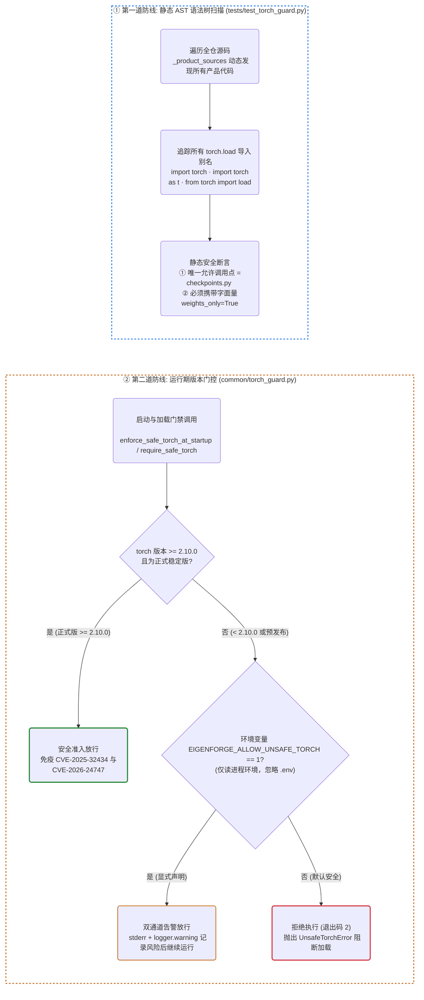
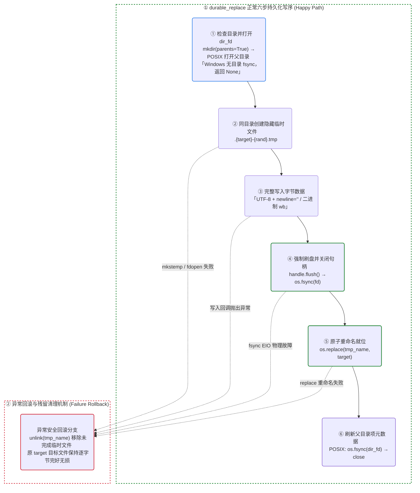
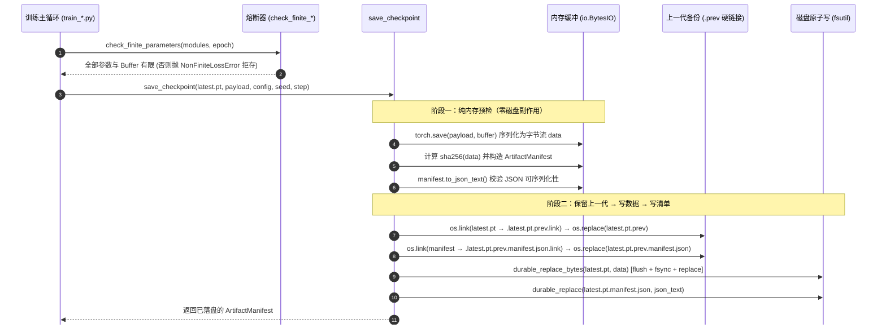
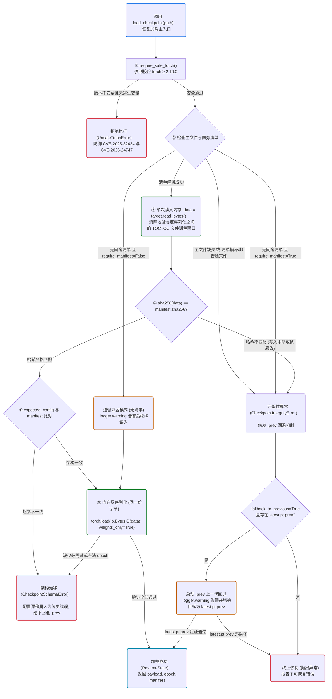

# 崩溃一致性持久化、产物溯源与安全规范（Checkpoint & Security Specification）

本文档阐述 `eigenforge` 在模型权重反序列化安全、耐久原子文件写入、崩溃恢复 Checkpoint 协议及产物全链路溯源上的工程设计与代码契约。

---

## 1. PyTorch 反序列化安全版本守卫（`src/eigenforge/common/torch_guard.py`）

### 1.1 威胁模型与双 CVE 版本底线

PyTorch 的默认 `.pt` / `.pth` 权重格式基于 Python `pickle`。历史上即便显式传入 `torch.load(..., weights_only=True)`，在旧版本 PyTorch 上仍存在两处高危安全绕过漏洞（细节见表 1）：

**表 1　PyTorch weights_only 反序列化已知漏洞与修复版本**

| 漏洞编号 / GHSA | 严重程度 | 受影响版本范围 | 首个修复版本 | 漏洞机理说明 |
| :--- | :---: | :---: | :---: | :--- |
| **CVE-2025-32434**<br>`GHSA-53q9-r3pm-6pq6` | Critical (CVSS v4 9.3) | `torch <= 2.5.1` | `2.6.0` | `weights_only=True` 受限反序列化器在旧版本上仍可被恶意构造的权重文件触发远程代码执行（RCE） |
| **CVE-2026-24747**<br>`GHSA-63cw-57p8-fm3p` | High | `torch < 2.10.0`<br>(`<= 2.9.1`) | **`2.10.0`** | `weights_only` 专用 unpickler 在解析畸形指令流时发生内存破坏，可导致任意代码执行 |

因此，本仓库将运行时安全底线强制设定为 `MIN_SAFE_TORCH = (2, 10, 0)`，对任何版本字符串 $v$ 解析为可比较四元组：

$$
\operatorname{parse\_version}(v) = \big(\text{major}, \; \text{minor}, \; \text{patch}, \; p\big), \qquad p = \begin{cases} -1, & v \text{ 为 } \text{a/b/rc/dev 预发布版} \\ 0, & v \text{ 为正式稳定版} \end{cases}
\tag{1.1}
$$

仅当 $\operatorname{parse\_version}(v) \ge (2, 10, 0, 0)$ 且 $p = 0$ 时判定为安全运行时。

### 1.2 双层防线（静态 AST 扫描 + 运行时版本门控）

两道防线的分工与判定路径见图 1；版本解析规则 $\operatorname{parse\_version}(v)$ 见式 (1.1)。



**图 1　torch.load 双层安全防线（静态 AST 扫描 + 运行期版本门控）**

1. **静态 AST 全仓扫描守卫（`tests/test_torch_guard.py`）**：
   - 动态遍历仓库所有产品源码，通过 AST 语法树追踪 `import torch`、`import torch as t` 与 `from torch import load` 等所有导入别名；
   - 强制断言：**全仓唯一允许调用 `torch.load` 的文件是 `src/eigenforge/checkpoints.py`**，且每一次调用必须携带字面量关键字参数 `weights_only=True`。
2. **运行时版本门控（`require_safe_torch` & `enforce_safe_torch_at_startup`）**：
   - 所有训练与遍历 CLI 在 `parse_args()` 之后、触碰任何磁盘文件之前调用 `enforce_safe_torch_at_startup()`；`load_checkpoint()` 与 `GenAIEvaluator._load_inception()` 内部亦无条件调用 `require_safe_torch()`；
   - 当运行时 PyTorch 低于 `2.10.0` 时，CLI 捕获 `UnsafeTorchError` 并以**退出码 `2`** 失败封闭退出。
3. **受审计的逃生舱口（`EIGENFORGE_ALLOW_UNSAFE_TORCH=1`）**：
   - 仅从**进程环境变量 `os.environ`** 读取（绝不从 `.env` 文件读取，防止克隆含恶意 `.env` 的目录自动放行）；
   - 仅当值严格等于字符串 `"1"` 时放行，且放行时强制通过**双通道**（`sys.stderr` 标准错误流 + `logger.warning` 持久化日志文件）输出包含两个 CVE 编号的显式告警。

---

## 2. 耐久原子文件替换原语（`src/eigenforge/common/fsutil.py`）

直接向目标路径覆写文件（如 `torch.save(obj, "latest.pt")`）或仅调用 `os.replace` 存在两类数据损坏风险：

1. 写盘中途进程被杀（SIGINT / OOM）会直接截断唯一的一份 `latest.pt`；
2. 在 ext4 等延迟分配（delayed allocation）文件系统上，若不先对文件数据执行 `fsync`，断电后重命名目录项可能先于数据块落盘，产生**长度为 0 的空文件**。

`durable_replace` 的六步写序与异常回滚路径见图 2。

### `durable_replace` / `durable_replace_bytes` 六步写序流程图



**图 2　durable_replace 六步持久化写序与异常回滚**

---

## 3. 崩溃一致性 Checkpoint 提交与恢复协议（`src/eigenforge/checkpoints.py`）

### 3.1 两阶段保存与 `.prev` 硬链接轮转时序图（`save_checkpoint`）

由于操作系统无法跨两个文件（`latest.pt` 与 `latest.pt.manifest.json`）提供原生双文件事务，`save_checkpoint()` 通过两阶段提交协议保证崩溃可恢复性（完整交互时序见图 3）：



**图 3　save_checkpoint 两阶段提交与 .prev 硬链接轮转时序**

### 3.2 同旁溯源清单 `ArtifactManifest` 与 Git 元数据（`src/eigenforge/artifacts.py`）

每次保存生成的 `<artifact>.manifest.json`（`manifest_schema_version = 1`）包含以下字段：

```json
{
  "manifest_schema_version": 1,
  "artifact_path": "experiments/eigengan/latest.pt",
  "artifact_sha256": "<64-char-lowercase-hex-sha256>",
  "model_kind": "eigengan",
  "seed": 42,
  "step": 6350,
  "training_config": { "z_dim": 128, "image_size": 64, "n_basis": 6, "..." : "..." },
  "dataset": { "name": "celeba", "root": "./data/celeba", "num_images": 202599 },
  "metrics": null,
  "git": { "commit": "<40-char-commit-sha>", "dirty": false },
  "created_utc": "2026-11-18T06:00:00Z"
}
```

### 3.3 单次读入防 TOCTOU 校验与故障回退决策图（`load_checkpoint`）

完整的验证流水线、`require_manifest` 两种取值下的行为差异与 `.prev` 回退条件见图 4 的决策树：



**图 4　load_checkpoint 防 TOCTOU 校验与 .prev 回退决策**

### 3.4 双层数值健康熔断器（`check_finite_losses` & `check_finite_parameters`）

1. **步级损失熔断 `check_finite_losses(losses, epoch=..., step=...)`**：
    - 时机：在每次 `loss.backward()` / `optimizer.step()` **之前**。
    - 行为：检查损失张量是否全部有限（`torch.isfinite`）；一旦出现 `NaN` 或 `Inf`，立即抛出 `NonFiniteLossError` 终止训练，防止坏梯度污染模型权重。
2. **轮级参数熔断 `check_finite_parameters(modules, epoch=...)`**：
    - 时机：在每个 Epoch 结束、调用 `save_checkpoint()` 之前。
    - 范围：遍历生成器、EMA 生成器与判别器的全部浮点参数（`parameters()`）与缓冲区（`buffers()`）。
    - 行为：若最后一步优化器更新或 AMP 缩放导致任何权重出现 `NaN/Inf`，立即抛出 `NonFiniteLossError` 拒绝写盘——磁盘上的 `latest.pt` 永远不会被爆炸的模型覆盖。

---

## 4. 纯张量权重安全互操作（`src/eigenforge/safetensors_io.py`）

针对仅需分发或加载生成器/EMA 纯张量权重的场景，`safetensors_io.py` 提供零 Pickle 执行路径的互操作封装（需安装可选依赖 `pip install -e ".[safetensors]"`）：
- `export_state_dict(state_dict, path, *, metadata=None)`：校验所有值均为 `torch.Tensor`（非张量对象立即抛 `TypeError`），转为 CPU 连续内存后在内存序列化，并经由 `durable_replace_bytes` 原子持久化；
- `import_state_dict(path, *, device="cpu")`：通过 `safetensors.torch.load_file` 安全加载张量字典；
- `metadata(path)`：通过 `safe_open` 只读解析文件头部元数据字典，无需加载完整张量权重。
