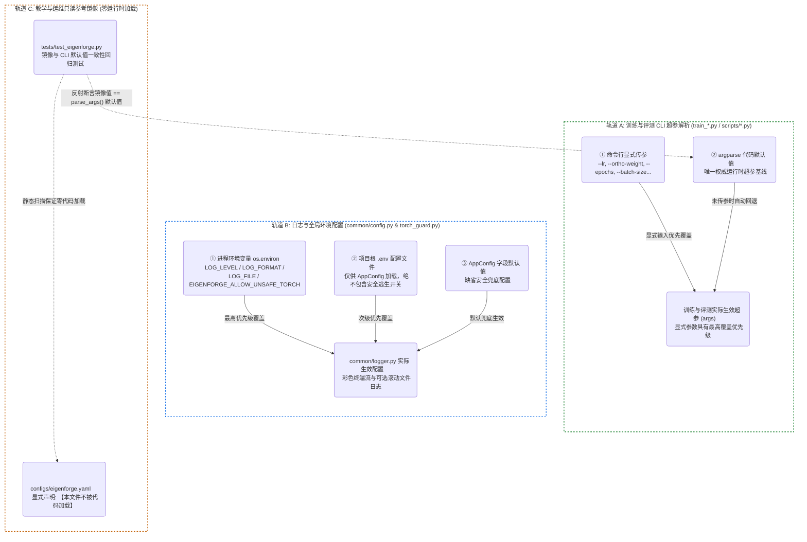

# CLI 命令与配置全量参考手册（CLI & Configuration Reference）

本文档提供 `eigenforge` 中配置系统（`AppConfig` 与 `configs/eigenforge.yaml`）以及全部 8 个可执行入口的参数签名、默认值、校验规则、退出码与输出文件规范。

---

## 1. 配置体系边界（`AppConfig` vs `configs/eigenforge.yaml`）

### 配置优先级与只读镜像隔离架构图

三条配置轨道的优先级关系与只读镜像隔离机制见图 1。



**图 1　配置优先级链与只读镜像隔离**

### 1.1 运行时配置 `AppConfig`（`src/eigenforge/common/config.py`）

`AppConfig` 基于 `pydantic-settings`（`BaseSettings`），默认从项目根目录 `<PROJECT_ROOT>/.env` 与进程环境变量加载（未声明的额外环境变量按 `extra="ignore"` 忽略）。全部环境变量映射见表 1：

**表 1　AppConfig 环境变量映射**

| 环境变量名 (`alias`) | `AppConfig` 字段 | 类型 | 默认值 | 说明 |
| :--- | :--- | :--- | :--- | :--- |
| `LOG_LEVEL` | `log_level` | `str` | `"INFO"` | Loguru 控制台与文件日志级别（`DEBUG` / `INFO` / `WARNING` / `ERROR`） |
| `LOG_FORMAT` | `log_format` | `Literal["human", "json"]` | `"human"` | `"human"` 为彩色人类可读格式；`"json"` 为结构化 JSON 序列化输出 |
| `LOG_FILE` | `log_file` | `str` | `"<PROJECT_ROOT>/logs/app.log"` | 滚动文件日志路径（10 MB 轮转，保留 14 天，zip 压缩，`delay=True` 延迟创建）；设为空字符串 `""` 时完全禁用文件日志 |
| `CELEBA_DATA_PATH` | `celeba_data_path` | `str` | `"./data/celeba"` | CelebA 数据集默认根目录 |
| `EIGENGAN_CHECKPOINT_DIR` | `eigengan_checkpoint_dir` | `str` | `"./checkpoints/eigengan"` | EigenGAN 默认权重目录配置项 |
| `DIFFUSION_CHECKPOINT_DIR` | `diffusion_checkpoint_dir` | `str` | `"./checkpoints/diffusion"` | 扩散模型默认权重目录配置项 |
| `DEVICE` | `device` | `str` | `"cuda"` | 默认计算设备配置项 |
| `EIGENFORGE_ALLOW_UNSAFE_TORCH` | （仅由 `torch_guard.py` 从 `os.environ` 直接读取） | `str` | 未设置 | **安全逃生舱口**：仅当进程环境变量中显式设为 `"1"` 时允许在 `< 2.10.0` 的 PyTorch 上运行并输出双通道告警；写在 `.env` 中无效 |

### 1.2 只读教学镜像 `configs/eigenforge.yaml`

- `configs/eigenforge.yaml` 是面向教学阅读与运维对照的**只读超参镜像，不被任何运行时代码导入或解析**。
- 回归测试 `tests/test_eigenforge.py::test_eigenforge_mirror_stays_non_authoritative_and_matches_cli_defaults`：
    - 自动扫描全仓源码，确保没有任何代码调用 `yaml.safe_load` 或读取 `configs/eigenforge.yaml`。
    - 同时强制断言该 YAML 文件中的 `image_size`、`batch_size`、`z_dim`、`n_basis`、`ortho_weight`、`r1_gamma`、`d_reg_every`、`lr`、`ema_decay`、`seed` 与 `train_eigengan.py` 的 CLI 默认值完全一致。

---

## 2. 模型训练 CLI 参考

### 2.1 简化版 EigenGAN 训练入口（`src/eigenforge/train_eigengan.py`）

**启动命令**：
```bash
python -m eigenforge.train_eigengan [OPTIONS]
# 或直接运行脚本：
python src/eigenforge/train_eigengan.py [OPTIONS]
```

**参数表**（完整参数与校验规则见表 2）：

**表 2　train_eigengan 完整参数**

| 参数名 | 类型 | 默认值 | 校验规则与行为说明 |
| :--- | :--- | :--- | :--- |
| `--data-root` | `str` | `"./data/celeba"` | `torchvision.datasets.ImageFolder` 根目录（至少包含 1 个子文件夹，且样本数 $\ge \text{batch\_size}$） |
| `--image-size` | `int` | `64` | 必须为 $\ge 8$ 的 2 的幂；决定生成器阶段数 $L = \log_2(\text{image\_size}) - 1$ |
| `--batch-size` | `int` | `32` | 训练批大小（`drop_last=True`；若数据集图片数 $< \text{batch\_size}$ 则抛 `ValueError`） |
| `--z-dim` | `int` | `128` | 全局潜向量维度 $d_z$ |
| `--n-basis` | `int` | `6` | 每层正交子空间基向量数量 $K$（要求 $1 \le K \le C_l$） |
| `--epochs` | `int` | `1` | 训练总轮数（正式训练通常设为 `50`–`100`） |
| `--lr` | `float` | `2e-4` | 生成器与判别器 Adam 学习率（$\beta = (0.5, 0.999)$） |
| `--ortho-weight` | `float` | `1.0` | `total_orthogonality_loss()`（归一化 Gram-MSE）权重；若需对齐官方未归一化正交项强度，在 $K=6, 64\text{px}$ 下需设为约 `90.0` |
| `--r1-gamma` | `float` | `10.0` | R1 梯度惩罚系数 $\gamma$（$\le 0$ 时禁用 R1） |
| `--d-reg-every` | `int` | `16` | 惰性 R1 触发步数间隔（非触发步不构建二阶计算图） |
| `--ema-decay` | `float` | `0.999` | 生成器 EMA 衰减率上限，带步级 warm-up（见下式） |
| `--output-dir` | `str` | `"./experiments/eigengan"` | 输出目录：保存 `latest.pt`、`latest.pt.manifest.json`、`latest.pt.prev` 及每 100 步的 `sample_<epoch>_<step>.png` |
| `--device` | `str` | 自动探测 (`"cuda"` / `"cpu"`) | 运行设备 |
| `--seed` | `int` | `42` | 全局随机种子（覆盖 `random`、`numpy`、`torch`、`torch.cuda`） |
| `--resume` | `str \| None` | `None` | 断点续训 Checkpoint 路径；校验 SHA-256 与 `(z_dim, image_size, n_basis)` 架构一致性 |
| `--allow-unverified-resume` | `flag` | `False` | 显式允许恢复缺少 `.manifest.json` 的旧版 Checkpoint |
| `--num-workers` | `int` | `0` | `DataLoader` 工作进程数 |
| `--no-amp` | `flag` | `False` | 禁用 CUDA 自动混合精度（CPU 下自动禁用） |
| `--deterministic` | `flag` | `False` | 开启 `torch.use_deterministic_algorithms(True)` 与 `cudnn.deterministic=True` |

---

### 2.2 官方布局版 EigenGAN 训练入口（`src/eigenforge/train_eigengan_faithful.py`）

**启动命令**：
```bash
python -m eigenforge.train_eigengan_faithful [OPTIONS]
```

**参数表**（完整参数与校验规则见表 3）：

**表 3　train_eigengan_faithful 完整参数**

| 参数名 | 类型 | 默认值 | 校验规则与行为说明 |
| :--- | :--- | :--- | :--- |
| `--data-root` | `str` | `"./data/celeba_aligned"` | 扁平图片文件夹路径（`FlatImageDataset`，直接扫描目录下 `.jpg/.jpeg/.png/.bmp`，样本数须 $\ge 2 \times \text{batch\_size}$） |
| `--dataset-name` | `str` | `"celeba"` | 记录于 `.manifest.json` 的数据集名称标识 |
| `--image-size` | `int` | `256` | 必须满足 $4 \times 2^{\text{len(z\_dims)}} = \text{image\_size}$ |
| `--z-dims` | `list[int]` | `[6, 6, 6, 6, 6, 6]` | 各层子空间维度列表 $q_0 \dots q_{L-1}$ |
| `--eps-dim` | `int` | `512` | 底部高斯噪声 $\varepsilon$ 维度 |
| `--epochs` | `int` | `160` | 训练总轮数（每轮迭代步数为 `len(loader) // 2`） |
| `--epoch-start-decay` | `int` | `160` | 线性学习率衰减起始轮次（`= epochs` 时保持恒定学习率） |
| `--batch-size` | `int` | `64` | 批大小（$\ge 1$） |
| `--lr` / `--beta1` | `float` | `1e-4` / `0.5` | Adam 优化器参数 |
| `--ema-decay` | `float` | `0.999` | 必须满足 $0.0 \le \text{ema\_decay} < 1.0$ |
| `--gp-weight` / `--gp-period` | `float` / `int` | `10.0` / `3` | 官方零中心梯度惩罚（`0-gp`）权重与惰性触发间隔 |
| `--orth-weight` | `float` | `1.0` | 官方正交项 $0.5\sum\|U_i U_i^\top - I\|_F^2$ 权重；设为 `0` 时自动切换为前向可微 Gram-Schmidt 正交化模式 |
| `--truncation` | `float` | `1.5` | 预览采样截断正态范围（必须有限且 $> 0$） |
| `--n-samples` / `--sample-every` | `int` | `100` / `1000` | 定期生成样本网格张数与步数间隔（`0` 禁用） |
| `--n-traversal` / `--n-left-axis-point` / `--traversal-every` | `int` | `5` / `10` / `2500` | 训练中途潜空间遍历条带样本数、单侧采样点数（总点数 $2n+1=21$）与步数间隔 |
| `--output-dir` | `str` | `"./experiments/eigengan_faithful"` | 输出目录（含 `latest.pt`、`samples/`、`traversal/`） |
| `--device` | `str` | 自动探测 (`"cuda"` / `"cpu"`) | 运行设备（仅 fp32，不启用 AMP） |
| `--seed` | `int` | `42` | 全局随机种子 |
| `--resume` / `--allow-unverified-resume` | `str` / `flag` | `None` / `False` | 断点续训路径与无清单放行开关 |
| `--num-workers` | `int` | `0` | `DataLoader` 工作进程数 |
| `--deterministic` | `flag` | `False` | 开启确定性算子内核（`use_deterministic_algorithms(True)`） |

---

### 2.3 DDPM / DDIM 扩散模型训练入口（`src/eigenforge/train_diffusion.py`）

**启动命令**：
```bash
python -m eigenforge.train_diffusion [OPTIONS]
```

**参数表**（完整参数与校验规则见表 4）：

**表 4　train_diffusion 完整参数**

| 参数名 | 类型 | 默认值 | 校验规则与行为说明 |
| :--- | :--- | :--- | :--- |
| `--data-root` | `str` | `"./data/celeba"` | `ImageFolder` 数据集目录（样本数须 $\ge \text{batch\_size}$） |
| `--image-size` | `int` | `64` | 图像尺寸（必须能被 4 整除） |
| `--batch-size` | `int` | `16` | 训练批大小 |
| `--num-timesteps` | `int` | `1000` | 扩散总时间步数 $T \ge 2$ |
| `--schedule` | `str` | `"cosine"` | 噪声调度类型：`{"linear", "cosine"}` |
| `--epochs` | `int` | `1` | 训练总轮数 |
| `--lr` | `float` | `1e-4` | AdamW 学习率（`weight_decay=1e-4`，带全局梯度裁剪 `max_norm=1.0`） |
| `--ema-decay` | `float` | `0.9999` | EMA 衰减率上限（带步级 warm-up，见下式） |
| `--output-dir` | `str` | `"./experiments/diffusion"` | 输出目录（每轮先原子保存 `latest.pt`，再用 EMA 模型执行 50 步 DDIM 采样生成 `sample_<epoch>.png`） |
| `--resume` / `--allow-unverified-resume` | `str` / `flag` | `None` / `False` | 断点续训路径（强制要求包含 `ema_model`，校验 `num_timesteps, image_size, schedule`） |

其中简化版 EigenGAN 与 DDPM 扩散训练器共享同一 EMA 预热（warm-up）衰减率公式（`ema_decay_at(step, decay)`）：

$$
\text{decay}_n = \min\!\left(\text{decay}, \; \frac{1 + n}{10 + n}\right), \qquad \theta_{\text{EMA}}^{(n)} = \text{decay}_n \, \theta_{\text{EMA}}^{(n-1)} + (1 - \text{decay}_n)\,\theta^{(n)}
\tag{1}
$$

**符号**：

- $\theta^{(n)}$——第 $n$ 个全局步（$\text{epoch}\times\text{steps}+\text{step}$）的在线训练参数；
- $\theta_{\text{EMA}}^{(n)}$——同步更新的 EMA 权重；
- $\text{decay}$——`--ema-decay` 上限。

---

## 3. 冒烟、质量门禁与潜空间遍历脚本参考（`scripts/` & `evaluation/`）

### 3.1 GPU/CPU 训练管线冒烟（`scripts/gpu_smoke.py`）

```bash
python scripts/gpu_smoke.py [--seeds 0,1,2] [--steps 2] [--output outputs/gpu_smoke.json] [--require-cuda]
```
- **退出码**：`0`（冒烟通过）、`1`（训练步进或采样发生非有限值 / 运行异常，同时记录 `logger.error`）、`2`（参数非法或指定 `--require-cuda` 但当前环境无 CUDA）。

### 3.2 三随机种子质量门禁（`scripts/quality_gate.py`）

```bash
# 仅验证协议可执行性（CI 默认模式，退出码 0）：
python scripts/quality_gate.py --seeds 0 --train-steps 2 --mode protocol --output outputs/quality_gate.json

# 显式阈值质量裁决模式（需在 CUDA 上运行且全部达标才退出 0）：
python scripts/quality_gate.py --seeds 0,1,2 --train-steps 20 --mode evaluate \
    --max-eigengan-loss-g 2.5 --max-ortho-error 0.05 --max-diffusion-loss 1.5
```
- **退出码**：`0`（`protocol` 模式完成，或 `evaluate` 模式下在 CUDA 上全部指标未越界）、`1`（指标越界 `fail` 或运行期异常）、`2`（`evaluate` 模式未传阈值、阈值为 NaN/Inf、或无 CUDA 诚实拒判 `not_evaluated`）。

### 3.3 简化版 EigenGAN 潜空间单轴遍历（`scripts/traverse_eigen_dims.py`）

```bash
python scripts/traverse_eigen_dims.py \
    --checkpoint experiments/eigengan/latest.pt \
    --image-size 64 --latent-dim 128 --n-basis 6 \
    --layer 0 --basis 0 \
    --output experiments/demo/traversal.png
```
- 默认要求 `--checkpoint` 具备同旁 `.manifest.json` 并校验 `(z_dim, image_size, n_basis)`；优先选取 `ema_generator` 权重渲染（若仅有 `generator` 则输出显式告警）。

### 3.4 官方布局版 EigenGAN 全维度遍历（`scripts/traverse_eigengan_faithful.py`）

```bash
python scripts/traverse_eigengan_faithful.py \
    --checkpoint experiments/eigengan_faithful/latest.pt \
    --output-dir ./experiments/eigengan_faithful/traversal_all_dims \
    --n-traversal 100 --n-traversal-point 17 --truncation 1.5 --seed 0
```
- 从已校验的 `.manifest.json` 中自动读取 `z_dims, eps_dim, use_gram_schmidt` 构造 `EigenGANGenerator`，按每层 $|L_{i,k}|$ 降序遍历所有潜维度，输出 `{sample:04d}_{layer}-{rank}-{|L|:.3f}-{dim}.jpg`。

### 3.5 论文 Tables 2–3 线性基准实验（`src/eigenforge/evaluation/toy_basis_similarity.py`）

```bash
python -m eigenforge.evaluation.toy_basis_similarity \
    --configs "5:1,5:3,10:1,10:3,10:5" \
    --losses "gan,lsgan,wgan,hinge_v1,fgan_kl" \
    --distribution both --n-datasets 100 --iters 2000 --batch-size 128 --lr 1e-4
```
- 对每组 `data_rank:subspace_rank` 与五种 GAN 损失训练线性 EigenGAN，并打印与 `linear_case_mle` 闭式 PCA 基的平均余弦相似度表格。
