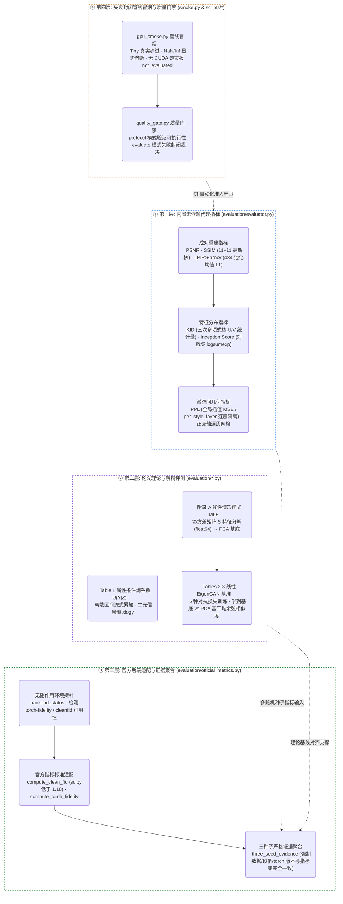

# 评测体系与质量门禁协议（Evaluation & Fail-Closed Quality Gates）

本文档完整定义 `eigenforge` 的四层评测与验证体系：**内置轻量代理指标**、**论文 Table 1 熵系数**、**可选官方评测后端与三种子证据协议**，以及**失败封闭（Fail-Closed）的训练冒烟与质量门禁状态机**。

---

## 四层评测与质量门禁架构总览

四层体系与跨层关联如图 1 所示；全文符号约定见表 1，门禁判定与退出码矩阵见表 2。



**图 1　四层评测与质量门禁体系架构**

---

## 符号与记号约定（Nomenclature）

**表 1　评测体系符号（`src/eigenforge/evaluation/evaluator.py` 等）**

| 符号 | 含义 | 首现公式 |
| :--- | :--- | :---: |
| $R$ | 像素动态范围 `data_range`（$[-1,1]$ 输入取 2.0） | (1.1) |
| $x, y$ | 待比较图像张量 | (1.1) |
| $\mu_x, \mu_y$ | 高斯窗局部均值 | (1.3) |
| $\sigma_x^2, \sigma_y^2, \sigma_{xy}$ | 高斯窗局部方差与协方差 | (1.3) |
| $C_1, C_2$ | SSIM 稳定常数 $(0.01R)^2, (0.03R)^2$ | (1.2) |
| $\operatorname{AvgPool2d}_{4\times 4}$ | $4\times 4$ 平均池化 | (1.4) |
| $D$ | 特征维度 | (1.5) |
| $k(u, v)$ | 三次多项式核 | (1.5) |
| $A, B$ | real/fake 特征子集（子集大小 $m$） | (1.6) |
| $n$ | 特征池容量 | (1.7) |
| $\mu_{\text{self}}, \mu_{\text{off}}$ | 核矩阵对角 / 非对角均值 | (1.7) |
| $p(y \mid x_i)$ | Inception 类别后验概率 | (1.9) |
| $\bar{p}(y)$ | 折内边缘类别分布 | (1.9) |
| $M$ | 每折样本数 | (1.9) |
| $z_1, z_2, t, \epsilon, \hat{u}$ | PPL 潜变量对、插值系数、扰动步长与单位扰动方向 | (1.11) |
| $c_l, \hat{v}$ | 第 $l$ 层子空间坐标与单位扰动方向 | (1.12) |
| $P_{b,a}$ | 区间 × 属性条件概率网格 | (2.2) |
| $H(\cdot)$ | 二元信息熵（nats） | (2.1) |
| $s_{i,m}, \mu_m, \sigma_m$ | 第 $i$ 种子指标 $m$ 的取值与总体聚合统计 | (3.1) |

---

## 1. 内置轻量代理指标（`src/eigenforge/evaluation/evaluator.py`）

`GenAIEvaluator` 提供无需外部第三方评测包即可确定性运行的指标与可视化辅助方法。

> **重要评测边界**：除显式调用 `compute_clean_fid` 或 `official_metrics.py` 外，以下内置方法均为同代码库内横向对比 Checkpoint 使用的**轻量代理指标**，不可直接与外部论文发表的 FID / StyleGAN-PPL 数值等同对比。

### 1.1 成对重建指标（`PSNR` / `SSIM` / `LPIPS-proxy`）

1. **峰值信噪比 `calculate_psnr(x, y, data_range=2.0)`**（默认适配 `Tanh` 输出范围 $[-1, 1]$，故 $R = 2.0$；若输入在 $[0, 1]$ 须显式传 `data_range=1.0`）：

$$
\operatorname{MSE}(x, y) = \frac{1}{B C H W}\|x - y\|_2^2, \qquad \operatorname{PSNR}(x, y) = 10 \log_{10}\left(\frac{R^2}{\operatorname{MSE}(x, y)}\right)
\tag{1.1}
$$

2. **结构相似性 `calculate_ssim(x, y, data_range=2.0, kernel_size=11)`**：
   采用 $11\times 11, \; \sigma = 1.5$ 的归一化二维高斯窗 $w$ 按通道分组卷积，计算局部统计量 $\mu_x, \mu_y, \sigma_x^2, \sigma_y^2, \sigma_{xy}$：

$$
C_1 = (0.01 R)^2, \qquad C_2 = (0.03 R)^2
\tag{1.2}
$$

$$
\operatorname{SSIM}(x, y) = \mathbb{E}\left[\frac{(2\mu_x\mu_y + C_1)(2\sigma_{xy} + C_2)}{(\mu_x^2 + \mu_y^2 + C_1)(\sigma_x^2 + \sigma_y^2 + C_2)}\right]
\tag{1.3}
$$

3. **感知距离轻量代理 `calculate_lpips_proxy(x, y)`**：
   对 $4\times 4$ 平均池化后的特征图计算元素级均值 $L_1$ 损失（`F.l1_loss`），其中 $N_{\text{pool}} = B \cdot C \cdot \lfloor H/4 \rfloor \cdot \lfloor W/4 \rfloor$：

$$
\operatorname{LPIPS}_{\text{proxy}}(x, y) = \frac{1}{N_{\text{pool}}}\big\|\operatorname{AvgPool2d}_{4\times 4}(x) - \operatorname{AvgPool2d}_{4\times 4}(y)\big\|_1
\tag{1.4}
$$

### 1.2 分布距离指标：Kernel Inception Distance（`calculate_kid`）

`GenAIEvaluator.calculate_kid(real_features, fake_features, subsets=100, max_subset_size=1000, *, estimator="unbiased", clip_negative=True)`（`evaluator.py:86-188`）：

在特征空间 $[N, D]$ 上采用三次多项式核（Binkowski et al., ICLR 2018）：

$$
k(u, v) = \left(\frac{1}{D}\langle u, v \rangle + 1\right)^3
\tag{1.5}
$$

支持两种统计量模式：

- **`estimator="unbiased"`（默认，对齐 `torch-fidelity` 论文无偏 U-统计量）**：
  自相关项剔除对角线并按 $\frac{1}{m(m-1)}$ 归一化，交叉项保留全部元素并按 $\frac{1}{m^2}$ 归一化：

$$
\widehat{\operatorname{MMD}}_u^2(A, B) = \frac{1}{m(m-1)}\sum_{i \ne j} k(a_i, a_j) + \frac{1}{m(m-1)}\sum_{i \ne j} k(b_i, b_j) - \frac{2}{m^2}\sum_{i=1}^m \sum_{j=1}^m k(a_i, b_j)
\tag{1.6}
$$

  当两个子集从同一有限特征池（容量 $n$）中独立无放回抽样时，交叉项以 $1/n$ 概率抽中同一元素（记对角均值 $\mu_{\text{self}} = \mathbb{E}[k(x_i, x_i)]$、非对角均值 $\mu_{\text{off}} = \mathbb{E}_{i\ne j}[k(x_i, x_j)]$），理论期望为负值：

$$
\mathbb{E}\big[\widehat{\operatorname{MMD}}_u^2(X_{\text{sub1}}, X_{\text{sub2}})\big] = -\frac{2(\mu_{\text{self}} - \mu_{\text{off}})}{n} < 0
\tag{1.7}
$$

  当 `clip_negative=True`（默认）时，汇报均值裁剪为 $\max(\text{mean}, 0.0)$ 并在日志中同时打印原始未裁剪均值 `raw_mean`；当 `clip_negative=False` 时直接返回原始值。

- **`estimator="biased"`（V-统计量，平方 RKHS 范数，恒非负）**：

$$
\widehat{\operatorname{MMD}}_b^2(A, B) = \frac{1}{m^2}\sum_{i,j} k(a_i, a_j) + \frac{1}{m^2}\sum_{i,j} k(b_i, b_j) - \frac{2}{m^2}\sum_{i,j} k(a_i, b_j) \ge 0
\tag{1.8}
$$

### 1.3 Inception Score 与官方权重安全加载（`calculate_inception_score` / `_load_inception`）

- **官方权重预处理协议（`_inception_preprocess`）**：
  要求输入张量位于 $[0, 1]$ 且形状为 $[N, 3, H, W]$，直接调用 `Inception_V3_Weights.DEFAULT.transforms()`（`Resize(342) -> CenterCrop(299) -> ImageNet Normalize`），严禁以 `transform_input=True` 替代。
- **安全权重加载（`_load_inception`）**：
  显式调用 `require_safe_torch()` 后，通过 `Inception_V3_Weights.DEFAULT.get_state_dict(progress=True, check_hash=True, weights_only=True)` 加载权重，阻断 `torch.hub.load_state_dict_from_url` 默认 `weights_only=False` 的安全缺口。
- **对数域数值稳定 KL 散度公式**：
  使用固定种子 `Generator().manual_seed(2020)` 打乱样本并均分为 $S = \text{splits}$ 份。对第 $s$ 份样本的 logits 矩阵 $Z^{(s)} \in \mathbb{R}^{M \times 1000}$，直接通过 `log_softmax` 与 `logsumexp` 计算：

$$
\log p(y | x_i) = \operatorname{log\_softmax}(Z_i^{(s)}), \qquad \log \bar{p}(y) = \operatorname{logsumexp}_{i=1}^M \big(\log p(y | x_i)\big) - \ln M
\tag{1.9}
$$

$$
\operatorname{IS}_s = \exp\left(\frac{1}{M}\sum_{i=1}^M \sum_{y=1}^{1000} p(y | x_i)\big(\log p(y | x_i) - \log \bar{p}(y)\big)\right)
\tag{1.10}
$$

### 1.4 代理感知路径长度（`compute_ppl`）

- **全局插值模式（`per_style_layer=False`）**：

$$
z_{\text{mid}} = (1 - t)z_1 + t z_2, \qquad \hat{u} = \frac{z_2 - z_1}{\|z_2 - z_1\|_2}, \qquad \operatorname{PPL}_{\text{global}} = \mathbb{E}_{z_1, z_2, t}\left[\frac{1}{C H W}\left\|\frac{G(z_{\text{mid}}) - G(z_{\text{mid}} + \epsilon\hat{u})}{\epsilon}\right\|_2^2\right]
\tag{1.11}
$$

- **逐层解耦隔离模式（`per_style_layer=True`）**（固定全局 $z$，仅对目标层 $l$ 的子空间坐标 $c_l \in \mathbb{R}^K$ 沿单位方向 $\hat{v}$ 施加扰动）：

$$
\operatorname{PPL}_{\text{layer}}(l) = \mathbb{E}_{z, c_l, \hat{v}}\left[\frac{1}{C H W}\left\|\frac{G(z; \, c_l) - G(z; \, c_l + \epsilon\hat{v})}{\epsilon}\right\|_2^2\right]
\tag{1.12}
$$

---

## 2. 论文 Table 1 属性条件熵系数（`src/eigenforge/evaluation/entropy_coefficient.py`）

严格实现 EigenGAN 论文第 4.1 节 Eq. (6)–(10) 的解耦度量指标 $U(Y|Z)$。

给定条件概率网格 $P_{b,a} = p(y_a = 1 \mid z \in \text{bin}_b) \in [0, 1]$（其中 $b = 1, \dots, N_{\text{bins}}, \; a = 1, \dots, N_{\text{attrs}}$）：

$$
H(p) = -\big(p \ln p + (1 - p) \ln(1 - p)\big)
\tag{2.1}
$$

$$
H(Y_a | Z) = \frac{1}{N_{\text{bins}}}\sum_{b=1}^{N_{\text{bins}}} H(P_{b,a}), \qquad H(Y_a) = H\left(\frac{1}{N_{\text{bins}}}\sum_{b=1}^{N_{\text{bins}}} P_{b,a}\right)
\tag{2.2}
$$

$$
U(Y_a | Z) = \begin{cases} \operatorname{clamp}\left(\dfrac{H(Y_a) - H(Y_a | Z)}{H(Y_a)}, \; 0, \; 1\right), & H(Y_a) > 0 \\ \text{NaN}, & H(Y_a) = 0 \end{cases}
\tag{2.3}
$$

---

## 3. 可选官方评测后端与三种子证据协议（`src/eigenforge/evaluation/official_metrics.py`）

`three_seed_evidence(records, ...)` 对恰好 3 个不同随机种子（$S = 3$）的实验记录执行严格一致性校验（校验 `dataset_version`、`device`、`torch_version` 与指标名集合完全一致），并计算总体均值与总体标准差：

$$
\mu_m = \frac{1}{3}\sum_{i=1}^3 s_{i,m}, \qquad \sigma_m = \sqrt{\frac{1}{3}\sum_{i=1}^3 (s_{i,m} - \mu_m)^2}
\tag{3.1}
$$

---

## 4. 失败封闭（Fail-Closed）质量门禁状态机

### 4.1 训练管线冒烟协议（`src/eigenforge/smoke.py` & `scripts/gpu_smoke.py`）

- 对每个种子执行真实的 Tiny 规模（$8 \times 8$ 图像，`batch_size=2`）EigenGAN（D 步 + G 步 + 采样）与 DDPM/DDIM（加噪 + 去噪更新 + 4 步 DDIM 采样）训练步进。
- **反 `python -O` 剥离设计**：所有数值有限性校验均通过显式抛出 `SmokeCheckError(RuntimeError)` 实现，绝不使用 `assert`。
- **诚实设备标注**：无 CUDA 时报告如实输出 `"cuda_available": false, "device": "cpu", "quality_gate": "not_evaluated"`；传入 `--require-cuda` 且无 CUDA 时直接返回退出码 `2`。

### 4.2 三随机种子质量门禁（`scripts/quality_gate.py`）

完整裁决路径见图 2 的状态机流转，每种输入组合对应的 `quality_gate` 状态与进程退出码汇总见表 2。```mermaid
%%{init: {'flowchart': {'nodeSpacing': 70, 'rankSpacing': 85, 'padding': 16, 'diagramPadding': 14}}}%%
flowchart TD
    Start(" 　<br/>　 启动 scripts/quality_gate.py　 <br/> CLI 参数解析入口 ") --> ParseSeeds{"① 解析 --seeds 种子列表"}
    ParseSeeds -- "格式错误或空种子" --> Exit2_Seeds(" 　<br/>　 拒绝执行 (退出码 2)　 <br/> 输出错误 FAIL 到 stderr ")
    ParseSeeds -- "合法整数元组" --> CheckMode{"② 校验 --mode 与阈值"}

    CheckMode -- "evaluate 模式未传阈值" --> Exit2_NoThresh(" 　<br/>　 拒绝执行 (退出码 2)　 <br/> 拒绝无阈值默认放行 ")
    CheckMode -- "任一阈值为 NaN 或 Inf" --> Exit2_NaNThresh(" 　<br/>　 拒绝执行 (退出码 2)　 <br/> 拒绝非有限阈值绕过 ")
    CheckMode -- "参数与阈值合法" --> CheckSteps{"③ run_gate: 步数有效?"}

    CheckSteps -- "train_steps < 1" --> Exit1_RunErr(" 　<br/>　 执行失败 (退出码 1)　 <br/> logger.error + stderr FAIL ")
    CheckSteps -- "train_steps >= 1" --> RunTrain(" 　<br/>　 ④ 执行三随机种子 Tiny 训练协议　 <br/> 运行 GAN + 扩散模型步进并校验损失有限 ")
    RunTrain -- "出现 NaN/Inf (SmokeCheckError) 或异常" --> Exit1_RunErr
    RunTrain -- "三种子完成且 mode == protocol" --> OutProto(" 　<br/>　 门禁状态: not_evaluated (退出码 0)　 <br/> 仅证明协议可执行，不作质量背书 ")
    RunTrain -- "三种子完成且 mode == evaluate" --> CheckBreach{"⑤ 是否存在指标超标或非有限?"}

    CheckBreach -- "存在均值越界 (breaches 非空)" --> OutFail(" 　<br/>　 门禁状态: fail (退出码 1)　 <br/> 任何设备上越界均判失败 ")
    CheckBreach -- "全部指标未越界" --> CheckCUDA{"⑥ 是否具备可用 CUDA?"}

    CheckCUDA -- "否 (当前为 CPU 环境)" --> OutCPU(" 　<br/>　 门禁状态: not_evaluated (退出码 2)　 <br/> CPU 合成协议不可认证生成质量 ")
    CheckCUDA -- "是 (GPU 环境)" --> OutPass(" 　<br/>　 门禁状态: pass (退出码 0)　 <br/> 三种子训练全量指标均达标 ")

    style Start stroke:#1a73e8,stroke-width:2px
    style OutProto stroke:#0891b2,stroke-width:2px
    style OutPass stroke:#238636,stroke-width:2.5px
    style OutFail stroke:#d73a49,stroke-width:2.5px
    style Exit1_RunErr stroke:#d73a49,stroke-width:2.5px
    style Exit2_Seeds stroke:#c25e00,stroke-width:1.5px
    style Exit2_NoThresh stroke:#c25e00,stroke-width:1.5px
    style Exit2_NaNThresh stroke:#c25e00,stroke-width:1.5px
    style OutCPU stroke:#c25e00,stroke-width:2px
```

**图 2　quality_gate 失败封闭裁决状态机**

**表 2　quality_gate 判定语义与退出码矩阵**

| 运行模式 | 阈值与指标状态 | 硬件环境 | 输出 `quality_gate` 状态 | 进程退出码 | 判定语义说明 |
| :--- | :--- | :--- | :---: | :---: | :--- |
| 任一模式 | `--seeds` 非法/为空，或传入了 `NaN/Inf` 阈值 | 任意 | （直接拒判，无报告落盘） | **`2`** | 拒绝非法种子或无穷/NaN 阈值绕过 |
| `--mode protocol`（默认） | 阈值合法且 `--train-steps >= 1` | CPU 或 CUDA | `"not_evaluated"` | `0`（NaN 或 `train_steps<1` 时为 `1`） | 仅验证三种子训练与指标采集协议本身可执行，不做质量背书 |
| `--mode evaluate` | 未提供任何 `--max-*` 阈值参数 | 任意 | （直接拒判，无报告落盘） | **`2`** | 拒绝无阈值默认放行 |
| `--mode evaluate` | 任一指标均值越界（`mean > limit`）或指标非有限 | CPU 或 CUDA | **`"fail"`** | **`1`** | 任何设备上指标越界立即判失败 |
| `--mode evaluate` | 全部指标未越界 | **CPU（无 CUDA）** | **`"not_evaluated"`** | **`2`** | CPU 上的合成微小协议不能认证生成质量，诚实拒判 |
| `--mode evaluate` | 全部指标未越界 | **CUDA** | **`"pass"`** | **`0`** | 仅在具备 CUDA 且全部显式阈值达标时放行 |
