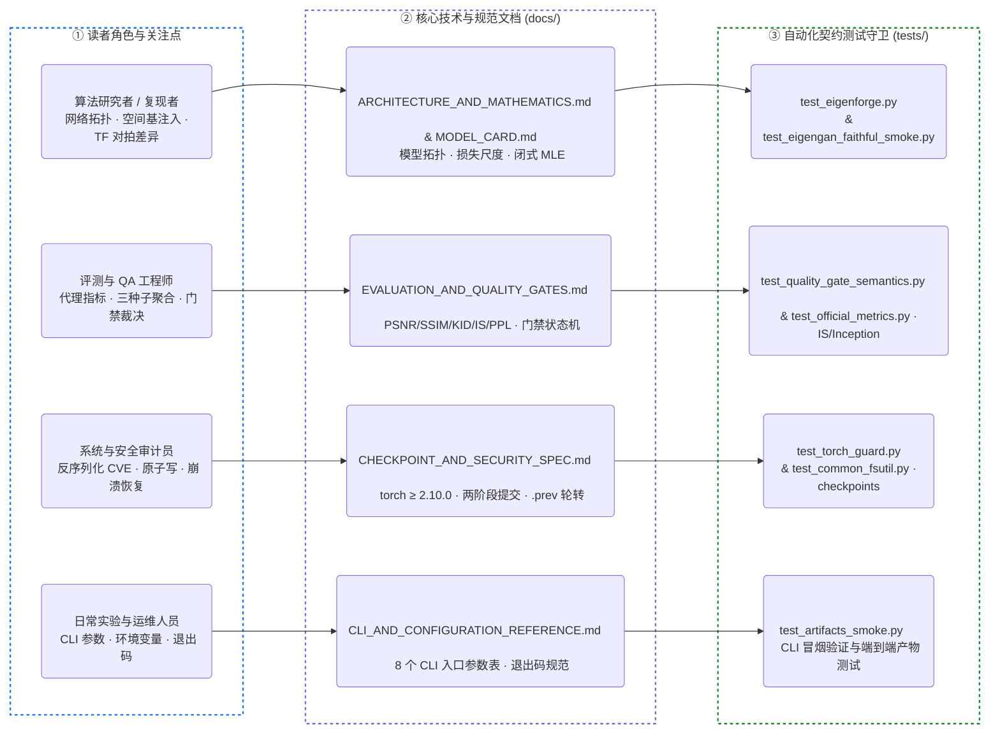

# `eigenforge` 文档体系总览与导航索引

本目录包含 `eigenforge`（EigenGAN 与 DDPM/DDIM 生成式建模套件）的完整工程与数学技术文档。所有文档均基于 `src/eigenforge/`、`scripts/` 与 `tests/` 的真实源码编写，所有公式、默认参数、异常类型、退出码与安全不变量均与代码逐一对齐并由回归测试锁定。

---

## 一、文档导航与阅读路径图

**图 1　读者角色 → 核心文档 → 契约测试守卫映射**

---

## 二、文档矩阵（按主题与读者角色划分）

各文档的定位、适用读者与覆盖范围见表 1；源码模块、文档章节与测试文件的三向对应关系见表 2。

**表 1　文档矩阵（按主题与读者角色划分）**

| 文档 | 核心内容与覆盖范围 | 适用读者 | 对应核心源码模块 |
| :--- | :--- | :--- | :--- |
| **[MODEL_CARD.md](MODEL_CARD.md)** | **模型卡与复现边界声明**：模型身份、实测参数量、简化变体与官方 TensorFlow 实现（`LynnHo/EigenGAN-Tensorflow`）的逐项架构差异、TF 1.15/2.21 算子对拍记录及质量声明红线 | 全体使用者、评审专家、复现研究者 | `src/eigenforge/models/*` `src/eigenforge/train_*.py` |
| **[ARCHITECTURE_AND_MATHEMATICS.md](ARCHITECTURE_AND_MATHEMATICS.md)** | **模型架构与数学规范**： 1. 简化版 EigenGAN（`SubspaceLayer`、QR 符号稳定化、归一化 Gram-MSE vs `sum_half` 正交项、惰性 R1 二阶图）； 2. 官方布局版 EigenGAN（4D 空间特征基、TF `SAME` 非对称步长 2 卷积与转置卷积、`hinge_v1`、`0-gp`、可微 Gram-Schmidt）； 3. DDPM/DDIM 扩散调度与 U-Net（端点按 $1000/T$ 缩放、余弦调度、严格递减 `-1` 哨兵网格、$\hat{x}_0$ 裁剪防误差放大）； 4. 论文附录 A 线性闭式 MLE 与 Tables 2–3 玩具实验 | 算法工程师、深度学习研究者 | `models/eigengan.py` `models/eigengan_faithful.py` `models/diffusion_scheduler.py` `models/unet_diffusion.py` `evaluation/linear_case_mle.py` `evaluation/toy_basis_similarity.py` |
| **[EVALUATION_AND_QUALITY_GATES.md](EVALUATION_AND_QUALITY_GATES.md)** | **评测体系与质量门禁协议**： 1. 内置无网络依赖代理指标（`PSNR`、`SSIM`、`LPIPS-proxy`、`KID` 无偏 U-统计量与有偏 V-统计量、`Inception Score` 官方权重预处理与 `logsumexp` 数值稳定 KL、`PPL` 全局与逐层扰动隔离）； 2. 论文 Table 1 属性条件熵系数 $U(Y\|Z)$； 3. 可选官方评测后端（`clean-fid` / `torch-fidelity`）与三种子证据聚合协议（`three_seed_evidence`）； 4. GPU/CPU 冒烟与失败封闭（Fail-Closed）质量门禁状态机 | 评测工程师、QA / CI 维护者 | `evaluation/evaluator.py` `evaluation/official_metrics.py` `evaluation/entropy_coefficient.py` `smoke.py` `scripts/gpu_smoke.py` `scripts/quality_gate.py` |
| **[CHECKPOINT_AND_SECURITY_SPEC.md](CHECKPOINT_AND_SECURITY_SPEC.md)** | **崩溃一致性持久化、产物溯源与安全规范**： 1. PyTorch 反序列化安全底线（`torch >= 2.10.0`，防御 CVE-2025-32434 与 CVE-2026-24747）与 AST 静态调用点守卫； 2. 耐久原子文件替换原语（`fsutil.durable_replace` / `durable_replace_bytes`：同目录临时文件、`fsync`、原子 `os.replace`、POSIX 父目录 `fsync` 门）； 3. 两阶段 Checkpoint 提交协议、`.prev` 硬链接轮转、单次读入内存防 TOCTOU 的 SHA-256 校验、架构防漂移校验与双层 NaN/Inf 熔断器； 4. `safetensors` 零 Pickle 纯张量权重互操作 | 系统/安全工程师、MLOps 工程师 | `common/torch_guard.py` `common/fsutil.py` `checkpoints.py` `artifacts.py` `safetensors_io.py` |
| **[CLI_AND_CONFIGURATION_REFERENCE.md](CLI_AND_CONFIGURATION_REFERENCE.md)** | **CLI 命令与配置全量参考手册**： 1. `AppConfig` 环境变量 / `.env` 与只读镜像 `configs/eigenforge.yaml` 的职责边界； 2. 全部 8 个可执行入口（3 个训练器、2 个门禁/冒烟脚本、2 个潜空间遍历脚本、1 个玩具基准脚本）的完整参数表、默认值、校验规则、输出目录结构与退出码规范 | 运维人员、日常训练与实验使用者 | `common/config.py` `common/logger.py` `configs/eigenforge.yaml` `train_*.py` `scripts/*.py` |

---

## 三、源码模块与文档章节双向索引

**表 2　源码模块与文档章节双向索引**

| 源码路径 | 关键类 / 函数 | 对应文档章节 | 锁定该契约的测试文件 |
| :--- | :--- | :--- | :--- |
| `src/eigenforge/models/eigengan.py` | `SubspaceLayer`, `ResBlockUp`, `EigenGenerator`, `EigenDiscriminator`, `r1_penalty` | [ARCHITECTURE_AND_MATHEMATICS.md §1](ARCHITECTURE_AND_MATHEMATICS.md#1-简化版-eigengansrceigenforgemodelseigenganpy) | `tests/test_eigenforge.py` |
| `src/eigenforge/models/eigengan_faithful.py` | `SameStride2Conv2d`, `SameStride2ConvTranspose2d`, `gram_schmidt`, `official_init_`, `EigenGANGenerator`, `EigenGANDiscriminator`, `zero_centered_gradient_penalty` | [ARCHITECTURE_AND_MATHEMATICS.md §2](ARCHITECTURE_AND_MATHEMATICS.md#2-官方布局忠实版-eigengansrceigenforgemodelseigengan_faithfulpy) | `tests/test_eigengan_faithful_smoke.py` |
| `src/eigenforge/models/diffusion_scheduler.py` | `DiffusionScheduler`, `q_sample`, `p_sample`, `_build_time_grid`, `ddim_sample` | [ARCHITECTURE_AND_MATHEMATICS.md §3.1](ARCHITECTURE_AND_MATHEMATICS.md#31-扩散调度器-diffusionscheduler-与采样时序图) | `tests/test_eigenforge.py` |
| `src/eigenforge/models/unet_diffusion.py` | `SinusoidalTimeEmbedding`, `ResBlock`, `UNetDiffusion` | [ARCHITECTURE_AND_MATHEMATICS.md §3.2](ARCHITECTURE_AND_MATHEMATICS.md#32-时间条件去噪网络-unetdiffusion-拓扑图) | `tests/test_eigenforge.py` |
| `src/eigenforge/evaluation/evaluator.py` | `GenAIEvaluator` (`calculate_psnr`, `calculate_ssim`, `calculate_kid`, `calculate_inception_score`, `compute_ppl`, `generate_subspace_traversal_grid`) | [EVALUATION_AND_QUALITY_GATES.md §1](EVALUATION_AND_QUALITY_GATES.md#1-内置轻量代理指标srceigenforgeevaluationevaluatorpy) | `tests/test_eigenforge.py` `tests/test_review_final_inception.py` |
| `src/eigenforge/evaluation/entropy_coefficient.py` | `binary_entropy`, `entropy_coefficient`, `attribute_posterior_along_dim` | [EVALUATION_AND_QUALITY_GATES.md §2](EVALUATION_AND_QUALITY_GATES.md#2-论文-table-1-属性条件熵系数srceigenforgeevaluationentropy_coefficientpy) | `tests/test_eigenforge.py` |
| `src/eigenforge/evaluation/official_metrics.py` | `backend_status`, `compute_torch_fidelity`, `compute_clean_fid`, `SeedEvidence`, `three_seed_evidence` | [EVALUATION_AND_QUALITY_GATES.md §3](EVALUATION_AND_QUALITY_GATES.md#3-可选官方评测后端与三种子证据协议srceigenforgeevaluationofficial_metricspy) | `tests/test_official_metrics.py` |
| `src/eigenforge/evaluation/linear_case_mle.py` | `LinearCaseMLE`, `linear_case_mle` | [ARCHITECTURE_AND_MATHEMATICS.md §4.1](ARCHITECTURE_AND_MATHEMATICS.md#41-线性情形闭式-mle-解srceigenforgeevaluationlinear_case_mlepy) | `tests/test_eigenforge.py` |
| `src/eigenforge/evaluation/toy_basis_similarity.py` | `LinearEigenGAN`, `get_adversarial_losses`, `train_toy_basis`, `basis_similarity` | [ARCHITECTURE_AND_MATHEMATICS.md §4.2](ARCHITECTURE_AND_MATHEMATICS.md#42-线性-eigengan-与-pca-基余弦相似度实验srceigenforgeevaluationtoy_basis_similaritypy) | `tests/test_eigenforge.py` |
| `src/eigenforge/common/torch_guard.py` | `MIN_SAFE_TORCH`, `parse_version`, `is_safe_torch`, `require_safe_torch`, `enforce_safe_torch_at_startup` | [CHECKPOINT_AND_SECURITY_SPEC.md §1](CHECKPOINT_AND_SECURITY_SPEC.md#1-pytorch-反序列化安全版本守卫srceigenforgecommontorch_guardpy) | `tests/test_torch_guard.py` |
| `src/eigenforge/common/fsutil.py` | `durable_replace`, `durable_replace_bytes`, `atomic_write_json` | [CHECKPOINT_AND_SECURITY_SPEC.md §2](CHECKPOINT_AND_SECURITY_SPEC.md#2-耐久原子文件替换原语srceigenforgecommonfsutilpy) | `tests/test_common_fsutil.py` |
| `src/eigenforge/checkpoints.py` | `save_checkpoint`, `load_checkpoint`, `select_generator_state`, `check_finite_losses`, `check_finite_parameters` | [CHECKPOINT_AND_SECURITY_SPEC.md §3](CHECKPOINT_AND_SECURITY_SPEC.md#3-崩溃一致性-checkpoint-提交与恢复协议srceigenforgecheckpointspy) | `tests/test_checkpoints.py` |
| `src/eigenforge/artifacts.py` | `ArtifactManifest`, `git_metadata` | [CHECKPOINT_AND_SECURITY_SPEC.md §3.2](CHECKPOINT_AND_SECURITY_SPEC.md#32-同旁溯源清单-artifactmanifest-与-git-元数据srceigenforgeartifactspy) | `tests/test_artifacts_smoke.py` |
| `src/eigenforge/safetensors_io.py` | `export_state_dict`, `import_state_dict`, `metadata` | [CHECKPOINT_AND_SECURITY_SPEC.md §4](CHECKPOINT_AND_SECURITY_SPEC.md#4-纯张量权重安全互操作srceigenforgesafetensors_iopy) | `tests/test_official_metrics.py` |
| `src/eigenforge/smoke.py` & `scripts/gpu_smoke.py` | `run_smoke`, `aggregate_seed_metrics`, `SmokeCheckError` | [EVALUATION_AND_QUALITY_GATES.md §4.1](EVALUATION_AND_QUALITY_GATES.md#41-训练管线冒烟协议srceigenforgesmokepy--scriptsgpu_smokepy) | `tests/test_artifacts_smoke.py` |
| `scripts/quality_gate.py` | `run_gate`（阈值裁决内联于 `run_gate`） | [EVALUATION_AND_QUALITY_GATES.md §4.2](EVALUATION_AND_QUALITY_GATES.md#42-三随机种子质量门禁scriptsquality_gatepy) | `tests/test_quality_gate_semantics.py` |

---

## 四、社区治理与工程规范文件

- **根目录协作规范**：[../AGENTS.md](../AGENTS.md)
- **学术引用元数据**：[../CITATION.cff](../CITATION.cff)
- **开源许可证**：[../LICENSE](../LICENSE)（MIT License，含 `LynnHo/EigenGAN-Tensorflow` 署名说明）
