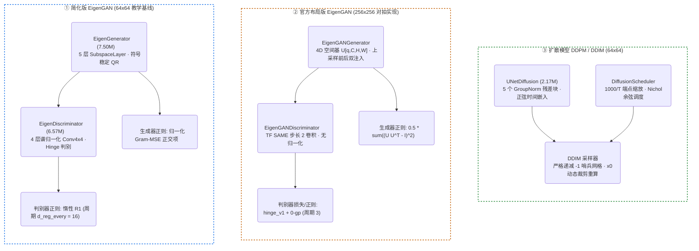

# EigenForge Model Card — EigenGAN & DDPM/DDIM

> 本卡片描述训练协议与质量评估边界。**它不构成任何训练质量声明**：本仓库
> 内置指标为轻量代理（详见 [EVALUATION_AND_QUALITY_GATES.md](EVALUATION_AND_QUALITY_GATES.md)），生成质量结论必须来自固定硬件、
> 固定数据协议下的评测，而非"测试绿"。截至本卡片，仓库**没有任何训练出来的
> 模型或真实指标**（开发环境无 CUDA、无 CelebA 数据）。
>
> **完整技术文档导航**：见 [docs/INDEX.md](INDEX.md)：
>
> - [模型架构与数学规范](ARCHITECTURE_AND_MATHEMATICS.md)
> - [评测与质量门禁](EVALUATION_AND_QUALITY_GATES.md)
> - [Checkpoint 与安全规范](CHECKPOINT_AND_SECURITY_SPEC.md)
> - [CLI 与配置参考](CLI_AND_CONFIGURATION_REFERENCE.md)

## 模型身份

两个模型族系的身份与实测参数量见表 1，三大族系的横向对比见图 1。

**表 1　模型身份与实测参数量**

| 属性 | EigenGAN | DDPM/DDIM |
| --- | --- | --- |
| 入口 | `src/eigenforge/train_eigengan.py` | `src/eigenforge/train_diffusion.py` |
| 生成器 | `EigenGenerator`（层级子空间基注入，7.50M 参数 @64px，5 层） | `UNetDiffusion`（时间条件 ε-预测，2.17M 参数） |
| 判别器 | `EigenDiscriminator`（谱归一化 + hinge，6.57M 参数） | — |
| 关键约束 | `total_orthogonality_loss` 归一化 Gram-MSE（训练基线尺度，不得改裸 Frobenius 求和） | DDIM 时间网格严格递减且以 -1 结尾 |
| 正则 | 惰性 R1（`--d-reg-every`，默认 16；`--r1-gamma` 控制强度） | — |
| 采样 | 截断隐空间遍历（`scripts/traverse_eigen_dims.py`） | DDIM（eta∈[0,1]，默认对预测 x0 做 [-1,1] 裁剪） |

参数量为 `sum(p.numel())` 实测（默认超参），非估算。

**图 1　三大模型族系横向对比**

## 训练协议

- 确定性：`--seed`（默认 42），`seed_everything` 覆盖 random/numpy/torch/cuda；`--deterministic` 另开确定性内核。
- 精度：CUDA 上默认 AMP（`--no-amp` 关闭）；CPU 自动禁用。
- 稳定性与 EMA：**只有生成器**带 EMA（EigenGAN decay 0.999，判别器无 EMA；checkpoint 只存 `ema_generator`）。
- 扩散模型 EMA decay 0.9999，并带 warm-up（与 TensorFlow `ExponentialMovingAverage(num_updates=…)` 同式）：

$$
\text{decay}(n) = \min\!\left(\text{decay}, \; \frac{1 + n}{10 + n}\right)
\tag{1}
$$

  **符号**：
  - $n$——全局更新步（$\text{epoch}\times\text{steps}+\text{step}$）；
  - $\text{decay}$——`--ema-decay` 配置上限。

- 数量级对照（warm-up 的必要性）：
    - 扩散模型（decay 0.9999，batch 16）：常数衰减在 12.7k 步 epoch 后初始随机权重仍占约 28%，而预览与采样用的正是 EMA 权重。
    - EigenGAN 使用同式 warm-up（`train_eigengan.ema_decay_at`，按 $\text{epoch}\times\text{steps}+\text{step}$ 全局步进）：
        - decay 0.999 常数衰减：前 1,000 步后仍留约 37% 初始权重；满一个 6.3k 步 epoch 后留约 $1.8 \times 10^{-3}$。
        - warm-up 启用后：1,000 步即把初始权重残留压至实质归零（$10^{-22}$ 量级）。
    - 两个训练入口的 warm-up 公式已由回归测试钉死一致。
- 数值保护：
    - 逐步检查损失有限；每个 epoch 存盘前再检查全部参数有限（损失检查看不到最后一次更新后的权重）。
    - 数据集小于一个 batch（`drop_last` 后 0 步）时直接报错，不再保存“epoch+1”的空训练 checkpoint。
- checkpoint 提交协议（`src/eigenforge/checkpoints.py`）：
    - 保存：先在内存里序列化并哈希，再保留上一代（`latest.pt.prev` + 其 manifest，硬链接），然后原子写 checkpoint，最后写带 sha256 的 manifest。
    - 恢复：只读一次文件字节，对**同一份字节**校验 sha256 与反序列化。
    - 回退：主文件缺失或校验失败时回退到上一代并发出告警。
    - 续训默认要求存在 manifest（`--allow-unverified-resume` 才允许无 manifest 的旧文件）。
- 加载安全：
    - 所有 `torch.load` 都经 `load_checkpoint`（字面量 `weights_only=True`），且要求 **torch ≥ 2.10.0**。
    - 依据：`weights_only=True` 在更低版本上不是安全边界（CVE-2025-32434 于 2.6.0 修复，CVE-2026-24747 于 2.10.0 修复）。
    - Inception 权重同样经 `weights_only=True` 加载。
- 数据：`ImageFolder` 格式 CelebA（`./data/celeba`），需自行准备，不集成自动下载。

## 与论文 / 官方实现的差异（请先读这里再解读结果）

官方实现只有 TensorFlow 版（`LynnHo/EigenGAN-Tensorflow`）；未发现官方 PyTorch 仓库。下表对照的是该仓库源码与论文（He, Kan, Shan, ICCV 2021, arXiv:2104.12476），逐项差异见表 2。

**EigenGAN 是简化变体，不是论文复现。**

**表 2　与官方 TensorFlow 实现（LynnHo/EigenGAN-Tensorflow）的逐项差异**

| 项 | 本项目 | 官方 |
| --- | --- | --- |
| 隐变量 | 共享 z（128 维），每层 `Linear(128→6)` 得系数 | 每层独立 z_i（6 维）+ 底部噪声 ε（512 维）经 FC 得 4×4×512 |
| 子空间基 U | 每层 `[6, C]`（逐通道向量，空间上广播） | `[H, W, C, q]`（带空间维度） |
| 重要性 L | softmax 均匀初始化，均值为 1 | 对角 `[18,15,12,9,6,3]` 起 |
| 注入位置 | 每个上采样块前加一次 | 每层两处（上采样前后） |
| 判别器 | 谱归一化 | 默认无归一化 |
| 惰性 R1 周期 | 16 | 3 |
| 分辨率 / 层数 | 64px / 5 层 | 256px / 6 层 |

因此**不能**把本实现学到的轴按论文解读为“逐层 PCA 方向”。语义可控性没有任何量化证据（遍历脚本只产出可视化）。

前向默认用 `torch.linalg.qr` 得到规范正交基（`strict_qr=True`），并强制 `diag(R) ≥ 0`：

- 问题：Householder QR 的列符号不唯一；不做归一化时，基向量某个元素过零会让整根轴翻号（实测一个元素只变 1e-5，规范正交基最大跳变 1.21；归一化后连续）。
- 关键：正交损失不经过 Q，所以此修复不改变损失尺度。
- 注意：`strict_qr=True` 时前向输出与原始基的范数无关，`ortho_weight` 只通过拉近原始基与正交基来间接起作用。

**正交项强度。** 本项目的 `total_orthogonality_loss` 是逐层归一化 Gram-MSE 再对层取均值，而官方是逐层 $0.5$ 倍 Frobenius 平方和并跨层求和：

$$
\mathcal{L}_{\text{eigenforge}} = \frac{1}{L}\sum_{l=1}^{L} \frac{1}{K^2}\big\|B_l B_l^{\top} - I_K\big\|_F^2, \qquad \mathcal{L}_{\text{official}} = \sum_{l=1}^{L} \frac{1}{2}\big\|B_l B_l^{\top} - I_K\big\|_F^2
\tag{2}
$$

**符号**：

- $B_l$——第 $l$ 层可学习基底矩阵（未经 QR 正交化的 `basis`，与架构文档 (1.7) 记号一致）；
- $K$——每层基向量数（默认 6）；
- $L$——层数；
- $I_K$——单位矩阵；
- $\|\cdot\|_F$——Frobenius 范数。

完整记号表见 [ARCHITECTURE_AND_MATHEMATICS.md](ARCHITECTURE_AND_MATHEMATICS.md) 符号约定节。

同等 Gram 误差下，由式 (2) 可得官方项是本项目的 $\frac{1}{2} K^2 L$ 倍：$K=6$、64px 共 $L=5$ 层 $\Rightarrow$ **90 倍**（已用 `orthogonality_loss(scale="sum_half")` 对照实测；官方 256px 6 层则为 108 倍）。

- 默认 `--ortho-weight 1.0` 因而只是很弱的锚定。
- 保持归一化尺度是硬约束；若要对齐官方强度，应把 `--ortho-weight` 调到约 90 并重训对比，而不是改损失尺度。
- 作为对照：原始课程实验 notebook 实际训练用 `orth_reg=100`、64px 共 4 层，等价权重 72，即约官方强度的 **1.4 倍**；重构把默认值降到 1.0（约官方的 1/90），这一变化此前没有记录。

**UNet 是教学级规模。**

- 它是真正的 U-Net（下/上采样、skip、正弦时间嵌入、GroupNorm），但只有 5 个残差块、2 次下采样、**无注意力**、2.17M 参数；DDPM 的 CIFAR-10 模型约 35.7M，且在 16×16 分辨率使用自注意力。
- 64×64 人脸的全局一致性大概率不足，不应称“论文级复现”。
- 要走向论文级需要更多块、注意力、宽度 ≥128，并暴露为 CLI 参数。

**论文本身没有 FID / IS / PPL / KID。**

- 论文只报告 CelebA 属性熵系数（Table 1）与线性 EigenGAN 对 PCA 基的余弦相似度（Tables 2–3）。
- 所以即使启用官方指标后端，也没有论文数值可供对标。

**扩散采样约定。**

- `ddim_sample` 默认裁剪预测 x0 到 [-1,1] 并据此重算 ε（`clip_denoised=True`，与 improved-diffusion / guided-diffusion / diffusers 一致）。
- cosine 调度末端 `√ᾱ_T≈1.6e-5`：不裁剪时 1e-3 的 ε 误差会被放大约 6e4 倍。
- `linear` 调度的 β 端点按 `1000/T` 缩放（T=1000 时与原值逐位相同）；否则 T=100 时 `ᾱ_T≈0.36`，x_T 不是 N(0,I)。

## 官方布局实现（已写，未运行、未训练）

模块清单见表 3，与官方 TF 1.15 源码的逐项对拍结果见本节末尾。

**表 3　官方布局实现模块清单（已写，未运行、未训练）**

| 文件 | 内容 |
| --- | --- |
| `src/eigenforge/models/eigengan_faithful.py` | `EigenGANGenerator` / `EigenGANDiscriminator`、`hinge_v1` 损失、`0-gp`、官方正交项、遍历 |
| `src/eigenforge/train_eigengan_faithful.py` | 官方超参的训练入口（复用 `checkpoints.py` 提交协议，`model_kind="eigengan_faithful"`） |
| `scripts/traverse_eigengan_faithful.py` | 官方 `test_traversal_all_dims.py` 的对应物：按 \|L\| 降序遍历每个维度，只渲染 EMA 生成器 |
| `src/eigenforge/evaluation/entropy_coefficient.py` | 论文 Table 1 熵系数的 Eq. (6)–(10)，分类器由调用方提供；概率越界/非有限值会显式报错，而不是静默算出错误数值。纯函数已对解析解自检（恒定概率 → 0、属性完全由 bin 决定 → 约 1），采样驱动函数仍需真实模型与属性分类器 |
| `src/eigenforge/evaluation/linear_case_mle.py` | 论文附录 A Eq. (43)–(46) 的线性情形 MLE 闭式解（µ、σ²、L、U=PCA 基）；零训练细节依赖。已对合成数据自检：基与 PCA 基一致、σ²≈0.0897 对期望 0.09、L²+σ² 复现特征值 |
| `src/eigenforge/evaluation/toy_basis_similarity.py` | 论文 Tables 2–3：线性 EigenGAN 对抗训练后与 PCA 基的余弦相似度（五种损失取自官方 `tfprob/gan/loss.py` 原文，数值已与官方 TF 侧逐位核对）；论文未给的协议以 docstring 逐项标注的默认值填充。已对 50 步玩具规模自检：六种损失有限、PCA 相似度随训练上升 |

逐项照 `LynnHo/EigenGAN-Tensorflow` commit `fc3e1a2`（MIT，Copyright (c) 2021 Zhenliang He，文件头已署名）：

- **潜变量与注入**：
    - 每层独立 `z_i`（6 层 × 6 维）加 512 维底部噪声经 FC 得 4×4×512。
    - `phi` 在每层上采样前后**各注入一次**（1×1 与 3×3-s2 转置卷积）。
- **子空间参数**：
    - `U[q,C,H,W]`：带空间维，正交初始化。
    - `L=[18,15,12,9,6,3]`：可训练。
    - `mu[C,H,W]`：零初始化。
- **判别器**：无谱归一化、无特征归一化。
- **初始化**：权重按官方 `variance_scaling(fan_in, truncated_normal)`（leaky_relu 增益）初始化（对拍细节见下）。
- **对抗损失**：`hinge_v1`，其生成器项是 `mean(max(1-f,0))`，**不是**旧代码里的 `-mean(f)`。
- **梯度惩罚**：对真实样本的 `mean(‖∇D‖²)`，**没有** 0.5 系数（旧 `r1_penalty` 有）；权重 10、每 3 个 D 步算一次并乘 3。
- **正交项**：`0.5·Σ(UᵀU−I)²`、跨层求和、权重 1。
- **优化与调度**：Adam(1e-4, β1=0.5)、EMA 0.999、每个 G 步 1 个 D 步。

与官方仍不同的地方：

- 步长为 2 的（转置）卷积按官方 `SAME` 对齐：
    - `SameStride2Conv2d`：偶尺寸下 `SAME` 只在下/右多补一个像素，故显式 `F.pad` 后 `padding=0`。
    - `SameStride2ConvTranspose2d`：转置 = 完整转置 `2n+1` 后去掉最后一行一列。
    - 对称 `padding=1` 不等价，会整体错开一个像素。
    - 前半已由 TF 源码确认：`tensorflow/core/framework/kernel_shape_util.cc` 的 `padding_before = padding_needed / 2`，且自带注释「For odd values of total padding, add more padding at the 'right' side」。
    - 转置形式由 `conv2d_transpose` 的转置定义推出，**未在 TF 里数值对拍**。
- NCHW 布局，进入 `fc` 的展平顺序不同（只是置换全连接单元）；转置卷积权重是 PyTorch 的 `[in, out, kh, kw]` 布局，所以**权重与官方 TF checkpoint 仍不通用**。
- 官方训练默认多卡（`tl.parellel_run` + 梯度平均，README 示例即双卡）；本实现单设备——全局 batch 语义不变（64 就是全局批大小），少的只是横向扩展能力。
- Gram-Schmidt 路径（`--ortho-weight 0`）已实现，并与官方 `tflib/ops/ops.py:34` 逐行核对一致（经典逐行正交化、可微）；官方对退化行同样没有零范数保护，实现照此保留。
- 学习率衰减已实现（`--epoch-start-decay`），与官方 `tflib/deep_learning/learning_rate.py:27` 核对一致：`start` 前恒定，之后 `lr0·(1 − (ep − start + 1)/(epochs − start + 1))`；默认 `start == epochs` 时从不衰减。仅 fp32，不用 AMP。
- 官方数据是用其 `scripts/align.py` 对齐裁剪后的 CelebA；对原始 178×218 图直接 `Resize` 会拉伸人脸。
- 初始化已对拍 TF 1.15（v1.15.0 tag）源码，关键处逐字引用：
    - **修正常数**（`tensorflow/python/ops/init_ops.py:522-526`）：
        - 注释原文（:523）：「# constant taken from scipy.stats.truncnorm.std(a=-2, b=2, loc=0., scale=1.)」
        - 公式（:524）：`stddev = math.sqrt(scale) / .87962566103423978`
    - **scale 归一**（:515-517）：scale 先除 `max(1., fan_in)`（`fan_in, fan_out = _compute_fans(scale_shape)`，:515），再开方、再除常数，与本实现 `gain/sqrt(fan)/0.8796…` 同式。
    - **`_compute_fans` 分支**（`init_ops.py:1415-1439`）：
        - `len(shape)==2`：`fan_in = shape[0]`（:1428-1430；tflib `fully_connected` 权重 `[num_inputs, num_outputs]`，`tflib/deep_learning/layers.py:29`）。
        - 更深形状走卷积 else 分支（:1431-1438），分支注释原文「Assuming convolution kernels (2D, 3D, or more).」「kernel shape: (..., input_depth, depth)」；`fan_in = shape[-2] * receptive_field_size`（:1437；tflib `convolution` 权重 `[kh,kw,in,out]`，`layers.py:99`）。
    - **`conv2d_transpose` 官方定义**（`nn_ops.py:2149-2154`）：
        - 原文：「The transpose of `conv2d`. This operation is sometimes called "deconvolution" after [Deconvolutional Networks], but is really the transpose (gradient) of `conv2d` rather than an actual deconvolution.」
        - filter 形状官方声明为 `[height, width, output_channels, in_channels]`（`nn_ops.py:2160-2162`；与 tflib `transposed_convolution2d` 的 `shape=[kernel_h, kernel_w, num_outputs, inputs.shape[c_axis]]`、`layers.py:168` 一致）。
        - 结论：`_compute_fans` 不特判转置 filter，`shape[-2]` 在此是**输出**通道（尽管分支注释写 `input_depth`），故 TF 的 fan_in 恰为 PyTorch `weight[0].numel()`（Linear/Conv2d/ConvTranspose2d 三层均成立）。

**数值核对已做的部分**（2026-10-09，隔离环境一次性 TF 2.21 对拍，随后拆除；脚本未入库）：

- 三种卷积算子在同一组随机输入/权重下与 TF 逐位一致：
    - `SameStride2Conv2d`：max|diff| = 0。
    - `SameStride2ConvTranspose2d`：max|diff| ≈ 6e-7。
    - `Conv2d(padding=1)` 与 TF 的 k=3/s=1 `SAME`：max|diff| = 0。
- `hinge_v1` 的 D/G 损失与官方 `tfprob/gan/loss.py` 在 64 个随机 logit 上逐位一致（1.957020 / 1.121918）。
- `0-gp` 在 6 点线性打分器上与 TF 逐位一致（1.498767）。
- `official_init_` 公式与 TF `variance_scaling(truncated_normal, fan_in)` 的采样分布吻合：512×128 权重 torch std 0.0614 vs TF 0.0616（ratio 0.997）；3×3×64×32 同理 ratio 0.995。

**未收尾**：整网 G 的逐层联合对拍——把官方 fc 权重 `eps→4096` 复制到本实现并跑完一次前向后最大偏差为 8.6e-1（应趋近 1e-6 量级），逐层接线中仍有未闭合的单元对应差异；在本机不再安装 TF 的前提下不再继续。

**状态：从未完整训练。** 已在 tiny 规模（8px 单层）由 `tests/test_eigengan_faithful_smoke.py` 冒烟回归：

- 前向/反向：U、L、mu 与卷积核梯度有限且非空。
- `traverse`：逐值出帧且不改写输入隐变量。
- `orthogonal_loss`：正交初始化下 ≈0，扰动后 >0。
- `gram_schmidt`：行正交；hinge/0-gp 损失有限；`D(G(z))` 形状 `[B,1]`。

以上只证明算子接线与数值健康，**不**构成任何官方对拍或质量声明。

- 记号约束：旧的 `total_orthogonality_loss` 归一化约束只针对 `EigenGenerator`；新模型用官方 `orthogonal_loss`，两者不可混用。
- 首次完整运行时应先核对的数字：
    - 生成器 `ΣU = 6,144,000`、`Σmu = 1,024,000`（256px，已用原始 notebook 的同构网络实测得到）。
    - 6 层输出分辨率依次为 8…256；`D(G(z))` 形状 `[B,1]`。

**Tables 2–3 已实现**（`evaluation/toy_basis_similarity.py`，未运行）：

- **论文给定部分逐字照做**：
    - 数据：y = Ax + b（Eq. 11）；x~N_d(0,I) 或 U_d(0,1)。
    - 五种损失（公式逐一取自官方 `tfprob/gan/loss.py`）：vanilla=BCE-with-logits、lsgan=MSE 1/0、wgan=−mean(r)+mean(f)、KL-f-GAN=−mean(r)+mean(exp(f−1))；hinge 复用已核对的 `hinge_v1`。
    - U 行正交约束：复用 `orthogonal_regularizer`，权重 1。
    - 与 PCA 基的余弦相似度；100 个随机数据集取平均（PCA 基经 `linear_case_mle` 取得）。
- **论文未给定的协议**：以显式默认值填充并逐项在 docstring 标注——A~N(0,I) 方阵、b~N(0,I)、线性判别器、Adam(1e-4, β=(0.5,0.999))、迭代数/批大小/样本数、|cos| 语义与按 |L|/特征值降序配对、HingeGAN 取 hinge_v1、KL-f-GAN 取 tricky。
- **结论边界**：其输出与论文表格数值不可对标（论文数值依赖未公开的协议），只能定性验证「对抗训练的线性 EigenGAN 基接近 PCA 基」这一结论。
- **关联实现**：线性情形的 MLE 闭式解（Eq. 43–46）另按原文实现为 `evaluation/linear_case_mle.py`（U 即 PCA 基，按构造成立）。
- **熵系数**：仍需调用方提供 CelebA 属性分类器——论文同样未给结构，且论文自己也把分类器当作外部预训练资产，故不在此发明。

## 质量评估边界

1. **冒烟 ≠ 质量**：`scripts/gpu_smoke.py` 只验证训练管线在目标设备可执行且
   数值健康（无 NaN/Inf）。无 CUDA 时报告 `quality_gate="not_evaluated"` 并在控制台注明“不是 GPU/AMP 验证”；GPU runner 上加 `--require-cuda`，没有 CUDA 就直接退出 2，避免静默 CPU 回退被当成 GPU 验证。
2. **门禁判定是失败封闭的**：`quality_gate.py --mode evaluate` 对 NaN/inf 阈值退出 2；非有限指标计为越界；越界在任何设备上判 `fail`（退出 1）；未越界但无 CUDA 只报 `not_evaluated`（退出 2）——CPU 上的 tiny 合成协议不能认证质量，只有 CUDA 上未越界才判 `pass`。
3. **代理指标 ≠ 论文可比**：仓库内置 PPL/KID/IS 为依赖无关的轻量代理；IS 依赖
   torchvision Inception 官方预处理协议（`Inception_V3__Weights.DEFAULT.transforms()`）。PPL 是线性插值上的像素 MSE（非 slerp、非 LPIPS、无分位裁剪），**只能用于同一代码库同一协议下比较 checkpoint**。
   与论文数值比较必须启用 Clean-FID 等官方后端并固定数据协议。
4. **三种子基线**：质量结论要求在固定 GPU 环境以 ≥3 个随机种子训练并报告
   mean/std（`gpu_smoke.py --seeds 0,1,2` 输出协议样例；完整训练评测待 GPU runner）。三种子汇总（`three_seed_evidence`）要求数据集版本/设备/torch 版本一致且各种子指标名一致，checkpoint 哈希按种子逐个列出。
5. **产物追溯**：正式训练保存 checkpoint 时同旁生成
   `ArtifactManifest`（产物 sha256、配置、种子、step、git 元数据；git 信息取自代码所在仓库而非当前工作目录），
   使任何产物可回答"谁、何时、用什么配置、什么数据训练的"。

## 已知边界

- 未在 GPU 上进行完整训练或三种子对比（本仓库开发环境无 CUDA；本机 torch 2.5.1 低于安全下限，训练入口会按设计退出 2）。
- 未与官方 EigenGAN/扩散基线做过同协议横向对比。
- 语义可控性（层级解耦）尚无 DCI 等量化证据；遍历脚本仅产出可视化。
- 评测可选依赖：`torch-fidelity>=0.4.0`；`clean-fid` 0.1.35 的 FID 路径调用 `scipy.linalg.sqrtm(..., disp=False)`，SciPy 1.18 已删除该参数，故 `eval` extra 把 SciPy 钉在 `<1.18`（静态推断，未在 SciPy 1.18 上实跑）。
